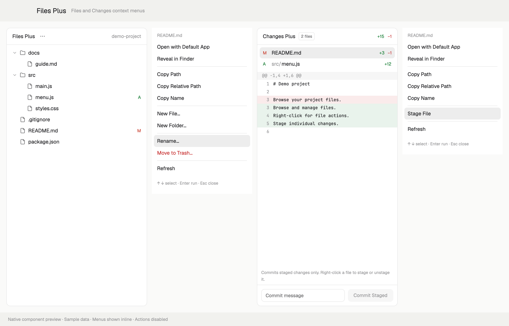

# Agent Workspace

[中文使用说明](使用说明.md)

Native Herdr mods for files, Git changes, saved agent sessions, project navigation and account quota. The personal layout is named **Agent-Workspace**; runtime mod IDs remain `files-plus`, `sessions-plus`, `project-spaces` and `agents-plus`.

## 0.16.0

- **Live context** appears beside exact local Claude Code and Codex sessions in Sessions, Agents Plus and the unified sidebar. The footer checks every 20 seconds while the window is active, and at once when it becomes active again, up to 40 agents and 8 MiB per check. Percentages warn at 80% and 90%. Unknown or exceeded windows show tokens. A successful check republishes an unchanged reading at most once per minute. Readings expire after two minutes without a new publication and are hidden in screenshot mode.
- **Plan price** in Stats and Usage stats accepts an optional monthly USD price for each provider. The multiplier compares estimated API cost with that price, prorated for the seven-day view. Partial and unpriced results have no multiplier.
- **Claude subagents** can expand beneath their parent in Agents Plus and the unified sidebar, up to 20 records per agent. Known states have labels. Clicking a record focuses the parent terminal.
- **Fork** in the Sessions row menu uses the original directory and store of an exact local Claude Code or Codex session. It opens a new tab in the local space for that directory, or creates a space if there is no match. Sessions also matches transcript text once a three-character query settles for 600 ms. It searches up to 300 recent sessions within the current filters, with a 50-hit and 10-second limit. Partial searches are marked. No index or transcript text is cached.
- **Interrupted sessions** in Sessions and Launch offer manual resume for retained local terminals whose root process changed and whose exact session is no longer running. Resume opens a new tab in the recorded local space if available, then falls back to a local space for the session directory or creates a new space. The recovered shell stays open. The footer retains up to 40 records for seven days. **Resume all** keeps the current focus.
- **Zen mode** hides the footer, top toolbar, right panel and sidebar. Launch shows Zen mode and its shortcut when the current layout has a Zen binding. Leaving Zen restores the surfaces that were visible on entry. Run `node configure-launcher.mjs` to bind **Cmd+Option+Z** on macOS or **Ctrl+Shift+Z** elsewhere in the installed layout with a Sessions Plus footer. Conflicting keys are preserved. You can also exit with `herdr-app do layout.show --id status`.
- **Project icons** in the sidebar preferences are on by default. The sidebar checks a project's local folder for a supported icon at startup, when the set of roots changes, or on **Refresh**. Remote and multi-root projects keep their usual icon. The private cache under `data/project-icons/` holds up to 200 files.
- **Auto tab titles** in Sessions → Tools is on by default. The footer names an eligible unnamed local tab with one agent from its session alias or verified title, with up to 40 characters. Renaming a tab yourself takes over its title. Screenshot mode temporarily clears automatically managed titles in Herdr’s native tab bar. **Reveal** restores those titles while Auto tab titles is on. Turning the setting off clears titles still owned by the feature.
- **Checks**: periodic timers no longer start while `herdr-app check` loads a mod, so the check reports no stranded tasks. A live window keeps the same refresh timers.

Gallery inspirations include [Context Monitor](https://github.com/EMRahman/herdr-context-monitor), [worthit](https://github.com/namastex888/worthit), [agents-plus](https://github.com/jbped/herdr-mods), [hopback](https://github.com/avgvi/herdr-hopback), [Revive](https://github.com/jchen0824/herdr-mods), [Zen](https://github.com/CodeyPacker/herdr-mods), [Space icons](https://github.com/sockiplastsmurfen/herdr-space-icons) and [Auto Title](https://github.com/kryptamine/herdr-auto-title).

## 0.15.0

- The footer quota popover has a **Stats** page beside **Quota**: Claude Code and Codex tokens (also excluding cache reads), requests, sessions and estimated cost for **Last 7 days** or **This month**, with a daily sparkline per agent. **Details** (also **Launch → Usage stats** and **Sessions → Tools**) adds a 30-day chart by cost or tokens, a per-model table (requests, input, output, cache read/write, total tokens and cost), projects grouped by Git checkout, and the largest sessions; a session opens its work timeline.
- Data comes from local Claude Code (`~/.claude/projects`, subagents included) and Codex (`~/.codex/sessions`) logs. Antigravity is not included, because its local data records no token usage. Repeated message records and resumed sessions are counted once. Cost is an estimate at API list prices (cache reads and 5-minute/1-hour writes, fast mode or priority tier, long-context rates), not a subscription bill; models without a listed price are marked **Unpriced**.
- Appended logs are read from where the previous run stopped. The cache under `<Herdr home>/data/usage-stats/` (folder 0700, file 0600) holds only counts, model names, times, session IDs and folders, never message text. A first read of about 1.3 GB of logs takes a few seconds; later reads take a fraction of a second.
- Session titles skip slash-command and harness turns, so a session started with `/clear` is named after its first real prompt, in Sessions too.
- The agy quota strip lists the 5h window before 7d. Dialogs share one 14px frame, so their scrollbars line up.

## 0.14.3

- Sidebar rows omit a folder path that ends in the row's own name; the tooltip keeps the full path. Idle agents keep their status dot without the word, and working time reads **for 7m**, apart from **12m ago** activity.
- Open projects drop their space count, which stays for folded or filtered projects; counts have tooltips. A **Projects** heading marks where the ordinary list resumes after Pinned or Needs attention.
- Files: plain folders use a neutral color while typed folders keep theirs. Git state stays in the trailing dot or letter; only deleted and conflicted names take its color.
- Footer quota shows reset countdowns in the dim color, and the window measured by the bar is brighter. **Launch** and **Commands** share one form with their bound shortcuts. A lone terminal pane under a tab of the same name shows only its folder.

## 0.14.2

- Replace numbered items in the collapsed unified sidebar with centered folder, tab and program icons. Highlight the focused item with a subtle background and side marker.
- Move agent status dots to icon corners, separate the expand/new-space controls, and keep empty states and pagination compact at narrow widths.

## 0.14.1

- Connect sidebar tree guides across row spacing while preserving project, section and page boundaries in Detailed and Compact views.

## 0.14.0

- The footer spans the whole window, beneath both the sidebar and work area. New installs use it; existing supported layouts migrate with `node update.mjs --integrate-layout`.
- Dialog lists reserve space for native scrollbars so row controls and text remain accessible.
- Ordinary terminals such as Bash and zsh have no agent-status badge; real agents show their status, including Idle.
- Sidebars use the terminal pane's corner radius and body spacing. The collapsed project rail has an expand button that restores its previous width. Plugin dialogs use Herdr's native frame, matching Settings.
- **N agents** opens a dialog with search, status filters, pinning and terminal navigation. It keeps sidebar visibility, width and filter unchanged, including without the optional Agents Plus sidebar.
- **Launch** opens a searchable launcher for live agents, spaces, saved commands, project presets and tools. Saved commands and presets open for review before execution. **Start an agent…** chooses a space, then an installed agent on that machine. Run `node configure-launcher.mjs` to add **Cmd+Option+P** on macOS (**Ctrl+Shift+Space** elsewhere), scoped to this layout; existing conflicting bindings are retained.
- Quota details compare used quota with elapsed time; amber indicates use more than ten percentage points ahead of time. This is a time benchmark, not a forecast; expired, stale and unknown windows have no pace reading. Progress bars have no added vertical lines.
- **Launch → Git overview** (also **Sessions → Tools**) scans local space/preset folders, with **Add folder** for other roots. It shows branch, worktree/index changes, conflicts, stash, ahead/behind and interrupted operations. It uses local refs without fetching. Limits: 12 roots, depth 4, 4,000 folders, 150 repositories and 20 seconds; partial scans are labeled.
- Markdown previews offer **Edit blocks** for paragraphs, lists and table cells. Changes share the source editor's draft, Save and conflict handling; **Close block** only exits the current block. Unsupported or large tables use a block source editor. Limits: 300 visible blocks and table grids up to 40 content rows, 20 columns and 300 cells. Use **Edit source** for the whole file.

These adaptations were informed by [Orca](https://github.com/VladTemp27/herdr-orca), [Usage Limits](https://github.com/nozikov/herdr-usage-limits), [ATD Launcher](https://github.com/doanhthong/herdr-atd-launcher), [Kanso Markdown Panel](https://github.com/jlopezlira/herdr-kanso/tree/main/markdown-panel) and [Git Dash](https://github.com/dougcunha/herdr-mods/tree/main/git-dash-app).

## 0.13.0

- Sidebar: single-line task titles with full tooltips, useful activity times, relative folder paths, quieter project colors, consistent indentation and pin counts. Idle badges are hidden and unused status columns release their space; pin slots remain stable.
- Typography: four shared TYPE sizes across all four mods, with native tab parity for the 12px Sessions button.
- Files and window chrome: root names share the Files title, filtering opens on demand, LICENSE/NOTICE/COPYING use document icons, Sessions matches the adjacent native tabs, and footer controls share a vertical center. The status-bar Privacy button is removed; Screenshot mode remains under Sessions → Tools. Quota retains its full Remaining/Used labels and reset countdowns.
- Consolidation: removed Inbox, Lineage and Services. The footer agent count opens the unified sidebar's Needs attention filter. References now become editable drafts directly in Pending prompts, where you choose an agent and send explicitly.



Preview images use sample data and may show an earlier interface. Dialogs close with **Esc** or a click outside; menus support **↑ / ↓**, **Enter** and **Esc**.

## Install, update and remove

Open Herdr once, keep it running, then run these commands from this repository or the archive's `workspace-plus/` directory. Requirements: Herdr mod APIs from **0.1.12+**, **Node.js 22+** (22.13+ for the SQLite WAL tests), Git, and the existing `hc` for project commands. Search uses an existing `rg`; PR / CI uses an authenticated `gh` on the selected machine. Local filesystem actions, session history and quota require macOS; folder listing also supports POSIX sh and Windows PowerShell.

```sh
node install.mjs
# Optional shared project/agent sidebar:
node install.mjs --unified-sidebar
# An existing installation:
node update.mjs
```

The home is `HERDR_APP_HOME`, defaulting to `~/.config/herdr-app`. Installation copies the mods and creates `layouts/Agent-Workspace.json` from `main`; existing destinations require the updater. To choose another home or source layout, use `--home /path/to/herdr-home --layout my-layout`. `--layout` affects creation of a missing plugin layout. Select the layout after checking:

```sh
app_home="${HERDR_APP_HOME:-$HOME/.config/herdr-app}"
HERDR_APP_HOME="$app_home" herdr-app check "$app_home/mods/files-plus"
HERDR_APP_HOME="$app_home" herdr-app check "$app_home/mods/sessions-plus"
HERDR_APP_HOME="$app_home" herdr-app do layout.switch '{"name":"Agent-Workspace"}'
```

Use the same `app_home` when installing with `--home`. If the right panel is hidden, click Files, Changes or Sessions; Herdr remembers visibility per space. Enable disabled native panels in workspace settings first.

The updater installs the current local source, replaces edits inside installed mod directories and removes obsolete files; **it creates no backups**. To obtain upstream source first, run `git pull --ff-only`. Existing layouts, shared state, notes and recovery data are retained. Options:

| Option | Use |
| --- | --- |
| `--files-only` | Install/update Files and Changes; leave existing Sessions untouched. |
| `--integrate-layout` | Explicitly migrate a supported layout to top-bar Sessions, a full-width footer and the file-preview pane header. |
| `--project-spaces` / `--native-spaces` | Enable project grouping or return to native Spaces. |
| `--agents-plus` / `--native-agents` | Enable configurable agent pin groups or return to native Agents. |
| `--unified-sidebar` / `--separate-sidebar` | Merge the two supported sidebar blocks or restore their recorded original structure. |

Ordinary updates preserve the selected layout structure and installed custom theme. Resolve an interrupted replacement error, then rerun the updater. A conflicting custom layout needs manual review before explicit migration. An existing Files-only layout is not automatically extended with Sessions.

For manual Files/Changes installation, copy `mods/files-plus/` into the Herdr home and duplicate a layout. Change the Files block to `"mod":"files-plus"` with no `role`; change Changes to that mod with `"role":"changes"`. Check before selecting the copy. To remove the pack, switch to the original layout and remove the installed owned mod directories and personal layout after preserving local edits, notes, drafts and any `session-trash/` recovery records. Herdr upgrades normally retain personal mods and layouts; use check to diagnose API compatibility.

## Files and previews

The **root-name ▾** title selects **Explorer / Recent / Pinned**; multiple roots use **Workspace**. Click the filter icon or **Cmd+F** while Files has focus to reveal **Filter files…**. It filters loaded entries; Esc clears and closes it, empty blur closes it, and a nonempty query stays open. The separate search icon searches filenames/content across the workspace. Use case/word/regex switches and include/exclude globs, then select a result for its source context or **Add reference**. Local search finds `rg` through PATH, common installation directories or the Codex standalone bundle; Search `props.rg` accepts an explicit executable. Limits: 500 matches, 30 per file, files up to 2 MiB, 2 MiB output and an 8-second local query.

Click a file in Explorer, Recent or Pinned to open a center preview tab. Reopening the same machine/root/path in one space focuses its existing preview. Breadcrumb directories navigate within the root; the pin beside a preview path toggles Pinned. Recent retains 20 entries per project, pins 40, and the last 40 projects, separately by machine. Choose flat or grouped-by-folder lists; folder × forgets that folder's recent entries, and **Clear** requires a second click within three seconds. The expand/collapse control opens four levels, at most 80 folders, or folds existing groups.

Right-click a file/folder, the blank tree area for the current directory, or the header **⋯** for the current selection. Copy absolute/relative paths or names, refresh, open with the default app, reveal in Finder, create, rename or move to Trash. New items go inside a selected folder or beside a selected file. **⋯ → Show Hidden Files** toggles dot names including `.git`. Mutations, system opening and Finder actions are local macOS features; remote views retain browsing and path copying. New destinations must be unused; Trash asks for confirmation. The root itself cannot be renamed or trashed. The tree shows up to 500 entries per folder and 5,000 total, with filesystem watching and a 10-second refresh.

Previews provide Markdown/source, expandable JSON, CSV/TSV tables and local image zoom. Text is limited to 400 KB; images to 16 MiB, with a 64 MiB/24-hour cache. **A− / A+** sets the remembered preview font from 10–24px; click its size to reset to 12px. Inside a preview, **Find / Cmd+F** (Ctrl+F elsewhere), **Enter / ↓**, **Shift+Enter / ↑**, **Aa**, and **Esc / ×** search source text, move through matches, toggle case and return to the prior view. Source Find supports up to 1,000 matches. Search and remote previews stay read only.

For a local text preview, **Edit**, then **Save / Cmd+S** writes against its captured disk version. A conflict offers **Copy my edits**, **Reload from disk**, or **Overwrite** with a second confirmation. A filename dot marks unsaved text; reopening offers **Restore / Discard** for drafts in `data/files-plus-drafts/`. CRLF line endings are retained. The preview pane header includes file name, folder, pin and actions; new installs and `--integrate-layout` configure it. Files, Changes and Sessions follow the preview's captured project context.

**Workspace folders** adds, removes and reorders up to eight roots on the same machine; click **Save folders**. Root headers fold independently. Header search covers all roots; a root's search is scoped to it. Results retain their root identity. **Remove / Reset to current folder** changes the mapping.

Markdown **Contents** lists up to 200 top-level headings; heading links, **Back** and **Whole document** navigate sections while preserving source drafts. Mermaid flowchart, sequence, state, class and ER fences render natively; errors retain source. Limits include 24 diagrams/document, 24,000 characters and 300 lines/diagram, and 15 seconds/batch. The bundled renderer uses Node. See [renderer notices](mods/files-plus/MERMAID-NOTICES.md); maintainers rebuild with `npm run build:mermaid` using the pinned build dependencies in `tools/mermaid`.

## Changes, History and review

Use **Changes / History ▾** and the **…** actions for **Tree / Flat**, **Graph**, **PR / CI**, **Review notes** and larger diffs. Changes separates **Staged / Unstaged** and supports **Inline / Side by side**. Drag the horizontal divider to resize the file list and diff; Changes, History and expanded previews remember their heights. History loads 50 commits/page; select one for the whole commit diff, or **↗** for the larger view and its **Files** list. Ahead/behind reflects the last fetched refs. Preview limits are 1,000 changed files and 2,500 tracked diff lines (1,500 untracked).

Right-click a changed file for paths, system opening, Finder reveal, **Stage / Unstage** and references. Partially staged files can offer both actions. Stage/Unstage starts immediately with progress, closes on success and offers Retry on failure. **Commit Staged** uses all staged changes plus the entered message, with the repository's usual Git hooks. In a local macOS regular tracked **M** text file, select a `@@` header or hunk arrows, then **Stage hunk / Unstage hunk**. Hunk actions update the index while retaining working files; conflicts, changed source versions, index locks and incomplete/binary diffs require refresh or whole-file actions.

Select a diff line, **Shift-click** a range, then **Comment selection / Comment file**. Open **Review** to edit the combined feedback and choose a live agent before sending. Comments retain their original code context and can become outdated; **Viewed** follows the content version. Review drafts are stored per machine/checkout, and uncertain delivery remains available for manual checking.

**PR / CI** uses the selected machine's authenticated `gh`: up to 40 PRs, 150 checks/PR, 50 initial review threads and 64,000 displayed log characters. Refresh, read failed logs, copy summaries or add them to Pending prompts. **Graph** draws up to 200 topological commits; filter by HEAD/branch, copy a SHA or open the commit diff. The ref picker supports 500 refs and 32 graph lanes. Both tools are read only; fetching remains a separate Git action.

## Sessions

Click **Sessions** after Changes to use the full right panel; click again to close it. **This folder / All folders**, the Agent/Source filter menu and search by title, path, provider or ID narrow the list. Source options include Main, Auto review, Subagent and Unknown. The **…** menu holds Notes, Project commands, Pending prompts, Session Trash, Projects and Tools; row **⋯** actions apply to that captured session.

Use **Switch** for a running Herdr session or **Resume** for local history in its original directory. Resume invokes `claude --resume <id>`, `codex resume <id>` or `agy --conversation <id>` with normal CLI configuration. **Rename** sets a local display name; empty restores the original. **Preview** reads the latest user/assistant text for local Claude/Codex on demand. History refreshes every 30 seconds, scanning up to 6,000 entries and 500 recent records/provider; large JSONL metadata is read from the ends. Codex archived records and nested Claude subagent files are excluded. Exact visible session IDs merge live/history entries; other live terminals remain separate.

History and agy summary metadata require local macOS; remote live sessions remain reachable in All folders. Set Sessions `content.props.node` if Node is outside Herdr's PATH, and `stores.claude` / `stores.codex` for custom stores; defaults follow `CLAUDE_CONFIG_DIR` / `CODEX_HOME`. agy resume uses its default store.

For stopped local history, **⋯ → Move to Trash…** shows the captured session and file list before confirmation. Use **Sessions … → Session Trash → Restore…** to unpack recognized transcripts/attachments to their original locations. The data directory must share the home volume; running, occupied, ambiguous or symbolic-link targets are rejected. Resolve existing destination conflicts before Restore. Keep Herdr's `session-trash/` records until recovery is complete; Finder Put Back restores only the bundle, and emptying macOS Trash removes its contents permanently. Failed moves retain recoverable records when rollback needs attention. Project files and shared provider indexes are retained.

## Pending prompts and notes

**Sessions … → Pending prompts**, a live row's prompt action, or **Add reference to pending prompts…** in Files/Changes opens the queue. Search **Add reference**, Notes, PR summaries, Timeline, Images and Screen picker open a new, prefilled **draft inside that queue**. Edit it and choose a live agent on its captured machine to append a pending item. Unassigned drafts persist and can be reopened, kept or removed; existing recipient items and composer text are retained. Select **Edit / Remove**, **Preview send…**, or **Preview send all…**, inspect the message, then **Send**. Sent items remain records; editing one makes it pending again. For uncertain delivery use **Check delivery…** and mark arrived or allow retry. Limits: 40 queues, 40 items/queue, 40 unassigned drafts, 12,000 characters/instruction and 48,000/send; larger captured drafts can be shortened before assignment. Closing the panel keeps drafts.

Open **Notes** from Sessions **…**, a session row, or a Project Spaces **Project notes** menu. **Project / Session / Global**, **All notes** and search cover saved and closed contexts. Typing pauses save automatically; **Save / Cmd+S** saves explicitly. **Restore draft** recovers unsaved text; conflicts retain the current text for copy or reload. **Versions** keeps three prior versions. Archive/unarchive, confirmed old-version clearing, and archived-note removal manage storage; a removed note's latest text remains in recovery. Notes live in `data/workspace-notes/notes.json` under the Herdr home. **Add to pending prompts…** uses the queue draft flow above.

## Project commands, presets and workspace tools

**Sessions … → Project commands**, or the matching Project Spaces context action, saves templates per captured machine/project. Enter title, absolute cwd and literal JSON argv, for example `["/bin/echo","hello world"]`; shell syntax requires an explicit shell executable. Save, favorite, reorder, edit and recover unfinished forms. **Run** starts a detached task; **Console** opens live or retained output; **Cancel run** confirms and rechecks its identity. Closing the panel leaves tasks running.

**Sessions … → Projects**, also under **Tools**, manages workspace presets: save, duplicate, edit, favorite or remove. Specify an existing checkout, machine, up to eight file roots, agent argv and one to three terminal entries. Review the launch plan, then **Launch** creates a new space/tabs. Inspect partial or uncertain results before another attempt; incomplete forms remain drafts.

**Session ⋯ → Work timeline / Session images** opens captured local Claude/Codex evidence. Use newer/older pages, Details, Copy evidence or Add to pending prompts; Timeline shows recorded times/durations, while images support zoom and Copy path. Pagination stops at 20 pages; images show 12/page and use a 24-hour/32 MiB/96-item cache. agy and remote history remain summary/live-session features.

**Sessions → Tools → Deliverables** stores project/machine file and HTTP(S) link records. Add or drop files, mark read/unread, search/filter, archive/restore, then open the selected file/link. Records live in `data/workspace-deliverables/store.json`. Explicit CLI registration:

```sh
node ~/.config/herdr-app/mods/sessions-plus/deliverables-helper.mjs add \
  --root /path/to/project --file reports/result.md --title 'Analysis result'
```

**Sessions → Tools → Screen picker**, also on live-session **⋯**, reads the captured terminal's screen and up to 200 history lines. **a–t** selects the current page; **Enter** copies. Preview paths, open HTTP(S) links, copy or add evidence to queue drafts. A replaced terminal or changed folder requires reopening.

**Sessions → Tools → Screenshot mode** hides all four owned mods and their dialogs. **Reveal** restores them. Terminal output, Herdr's native tabs and notifications, and unrelated mods remain visible. Automatically managed tab titles are temporarily cleared.

## Project and agent sidebar

Enable **`--unified-sidebar`** for one project/space/tab/task tree, or use `--project-spaces` and `--agents-plus` independently. **Projects / Status ▾**, search, **All / Active / Needs attention**, and **Expand all / Collapse all** navigate the shared tree. Active includes working/blocked/done; Needs attention includes blocked/done. The footer **N agents · N needs you** switches to Needs attention and expands a collapsed unified sidebar. Without that sidebar it explains how to enable it. Click a task to focus/peek its freshly verified agent; explicit child links fold within the tree.

Projects group a Git checkout and its worktrees, or a non-Git working folder. Drag spaces onto a project or use **Move to project**, **New project…**, **Back to…** and **Release moved spaces**; rename/color/reorder headers and use **+** for a new space. **Group by Project / Status / None**, **Sort Manual / Recent** and group folding remain available. Project + Manual keeps native space navigation in displayed order. State is kept in `project-spaces.v1`; the filter uses `project-spaces.filter.v1`.

Use **Display → Detailed / Compact** for row density, shared with Files/Changes/Sessions. Titles stay on one line with full tooltips; Detailed adds available activity context. Folders show relative paths, omit main/master branch decoration and retain full paths in tooltips. Idle status is hidden; other reported states remain visible. Right-click **Pin directory / Pin project**, or pin a task; hover the reserved pin control to unpin. Pinned/attention entries appear once, with their containing directories when appropriate. Search temporarily expands matches and clearing it restores folds.

Separate **Agents Plus** offers native Priority / Grouped by space sorting and pin placement **Together at top / Split by space / Inside groups**. Pins use Herdr `terminal.pin`, and next/previous-agent navigation follows the display. `--separate-sidebar` restores the recorded two-block structure; ordinary updates retain your selection.

## Footer quota, resources and theme

The quota strip follows device, branch and agent count. **Remaining / Used** switches the same readings; each provider shows up to two labeled percentage/reset windows such as `5h 71% 4h 1m · 7d 94% 6d 10h`. A 32px bar uses the lowest remaining window; click for all windows with their separate detail bars, reset times and update times. Missing five-hour resets use the documented 5h default; other unknown resets use —. Narrow layouts progressively hide bars, percentages and labels while retaining access through Quota. **Refresh** spins during reads and has a 60-second cooldown; hover for time/update/error information. **Quota → Agents** selects visible providers and retains access when all are hidden. Reads use local logged-in accounts on load and every five minutes; popup data is shared. Failed readings show warnings and may retain a **Stale** snapshot. After installing/signing into a CLI, Refresh checks it again.

Claude quota uses existing OAuth credentials and the Anthropic usage endpoint; reopen Claude Code to renew expired login. Codex uses `account/rateLimits/read` from its app-server. agy requires 1.1.11+ and its built-in `/usage`; an unexpected model turn pauses queries for that version. These are local account quotas, including while viewing a remote workspace. Mode and visibility preferences persist; snapshots stay in memory.

The memory/terminal badge before **commands** shows Herdr resident memory and terminal count. Hover for totals; click **Resources** for CPU history and Herdr/terminal process groups, fold groups or Refresh. Sampling uses local `ps` every five seconds, every two while open; 100% CPU is one core. Amber marks Herdr above 1.5 GB or 80% CPU. Windows hides the badge. Click **commands** for the command palette; its displayed shortcut follows the current binding.

Copy `themes/workspace-frosted.json` into the Herdr home's `themes/`, then select **workspace-frosted**. This optional black palette uses alpha over the layout canvas and a warm-gold cursor. For matching pane outlines set `content.pane.border.color` to `terminal_border` and `content.pane.focus.color` to `terminal_focus`. Native macOS dialogs retain their system appearance. Project menus temporarily suppress source hover tooltips while open.

## Validation and license

Run `npm test` and `herdr-app check mods/<mod>` for all four mods. macOS filesystem tests use isolated temporary files and session fixtures. For visual inspection in a running development instance, use `herdr-app status` and `herdr-app shot /path/to/preview.png`. The packaged previews are sample renders; interactive coverage is described in each delivery report. Publish this directory with its preview and recipe under the **herdr-mod** topic if sharing a separate repository.

Apache-2.0; see [LICENSE](LICENSE) and [NOTICE](NOTICE). Base components derive from [Herdr's shipped mods](https://github.com/herdrdev/herdr-app/tree/816d2057d83f0cbd3705926c0231fb12963ae0fb/defaults/mods). Runtime provider icons use Herdr-managed assets; legacy previews retain their [MIT icon notice](mods/sessions-plus/icons/LICENSE).
