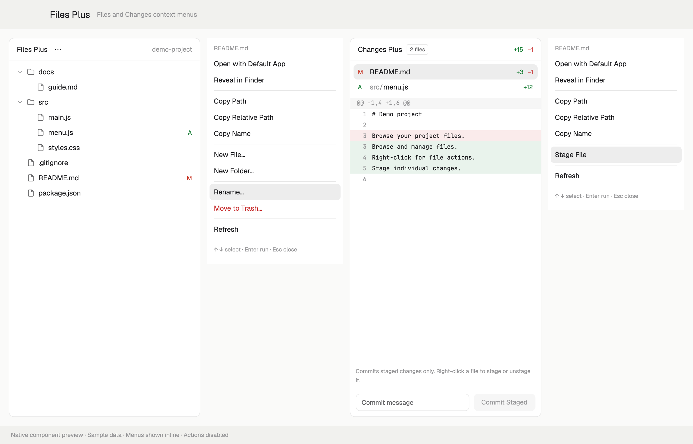
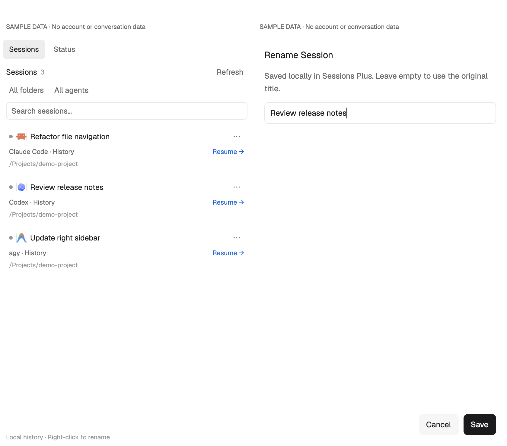
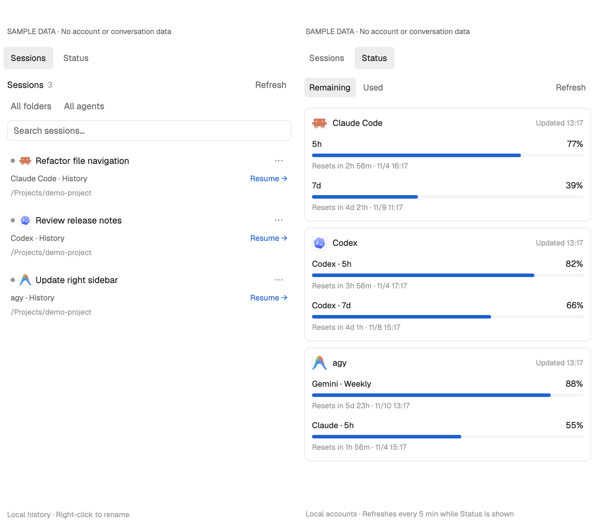

# Agent Workspace

[中文使用说明](使用说明.md)

A workspace enhancement pack for Herdr: Files and Changes context menus, plus Sessions and Status views for Claude Code, Codex, and agy. Copy paths, manage local files, stage individual Git changes, return to saved agent sessions, and check remaining or used account quota.



*Native component preview with sample data. Menus are displayed inline and actions are disabled; this is a rendering preview, not an end-to-end interaction capture.*

Agent Workspace is an independent mod pack. It does not modify Herdr's shipped Files or Changes mods or require a change to Herdr's core.

Previously released as **Files Plus** and **Herdr Workspace Plus**. The workspace is now **Agent Workspace**; Herdr uses the layout identifier **Agent-Workspace** because layout names cannot contain spaces. The `files-plus` / `sessions-plus` mod identifiers and shared-state keys remain compatible; the updater recognizes both the new layout name and an existing `files-plus` layout. Preview images below show earlier versions of the interface.

## Workspace additions

- **Files:** Markdown preview/source, expandable JSON, CSV/TSV tables and local images with zoom. The search icon opens filename/content search with case/word/regex switches and include/exclude globs. Selecting a match highlights its line with surrounding context. Local previews use Node. Local search discovers an existing `rg` in PATH, common installation folders, or the Codex standalone bundle; the Search view also accepts an executable path in `props.rg`. No packages or extensions are installed.
- **Changes:** separate Staged/Unstaged groups, Tree/Flat lists, Inline/Side-by-side diffs and an expanded diff dialog. **History** pages through 50 commits at a time and shows changed files and diffs. The branch header shows ahead/behind when an upstream is configured; it does not fetch.
- **Sessions:** source filters for Main, Auto review, Subagent and Unknown; date groups, short IDs and update times. **Preview** reads the latest user/assistant text on demand for Claude and Codex. Antigravity shows an explicit unsupported-message-preview notice. No persistent body index is created.
- **Agent inbox:** the footer inbox icon opens Needs you, Finished and Working groups. Click an entry to jump to its agent. **Dismiss** hides the current update; **Show dismissed** exposes hidden entries and **Show** restores one. New activity returns automatically. Without an activity sequence, **Snooze 1m** hides the update for one minute. These actions do not stop agents.

Local text previews are bounded to 400 KB; image previews to 16 MiB, with an app-owned cache limited to 64 MiB/24 hours. Local search stops at 500 matches, 2 MiB output or 8 seconds; remote search uses Herdr’s command limits. PDF previews, automatic AI recaps, and hook-based session details are not included.

Inside an open text preview, click **Find** or press **Cmd+F** (**Ctrl+F** on other platforms). Matches are highlighted in the file's source; **Enter / ↓** advances, **Shift+Enter / ↑** goes back, **Aa** toggles case matching, and **Esc / ×** restores the original preview. This searches the loaded text only (up to 400 KB and 1,000 matches), with an explicit notice at either limit. Dialogs have no title close button: click outside a dialog or press Escape to close it.

Text previews default to **12px**. Use **A− / A+** in the preview toolbar to choose **10–24px**, or click the displayed size to reset to 12px. The choice is remembered across files and restarts and applies to source, search results, Markdown, JSON and tables.

## Services, project presets and lineage

Sessions adds **Services**, **Projects** and **Lineage** below its header. These open bounded native dialogs and keep the existing layout.

- **Services:** read containers on the captured machine, grouped by Compose project (`database`, `gts`, `ai`, other), with unhealthy/stopped containers first, published ports and on-demand logs. **Restart…** requires a second confirmation and rechecks the Docker engine, complete container ID and creation time. TCP listeners show bind address, process and PID where permissions allow; selected local loopback URLs can be copied or opened after rechecking the listener. Containers follow that machine's Docker CLI context; listeners describe the machine itself. Missing Docker or port tools produce partial results. Refresh is explicit, with no polling, daemon startup, process killing or tunnel creation. Limits: 120 containers (40 per page), 2,000 listeners (100 per page), 300 log lines / 120,000 characters. Search covers the whole snapshot.
- **Projects:** manually save, duplicate, edit, favorite and remove workspace presets. A preset captures a machine, existing checkout, up to eight file roots, an agent argv and one to three terminal argv entries. Review the full launch plan, then explicitly **Launch** to create a new space and tabs. Setup uses the exact IDs returned by Herdr, with machine, folder, terminal identity and app labels checked before later steps. A partial or uncertain launch remains visible for inspection; it never retries automatically or deletes what was opened. Created terminals are interactive shell sessions; their existence does not prove the child command succeeded. Presets do not create worktrees, install packages or send prompts.
- **Lineage:** live core parent links form a searchable, foldable tree of agents and commands, across connected machines. Working/blocked filtering retains parent context. Missing parents and cycles are explicit; folders and titles never imply a relationship. Click a row to peek at its freshly verified terminal. Up to 200 live terminals are considered, with 50 rows per page and search over the full bounded snapshot; no provider transcript is read.

## Pull requests and Git graph

Changes adds **PR / CI** and **Graph** beside History.

**PR / CI** uses an existing authenticated `gh` on the captured machine. It shows at most 40 PRs, branch-name matches first, check states, review status, unresolved threads and on-demand failed Actions logs. Copy or explicitly add a PR summary to the existing pending-prompt preview. Reads happen on opening and Refresh; failed reads retain the previous snapshot as stale. There is no approve, comment, rerun or merge action. This installation has no `gh`; it was intentionally left uninstalled, and the panel reports it as unavailable. Real GitHub connectivity has not been validated. Details are bounded to 150 checks and the first 50 review threads, with a notice when more may exist. Logs display at most 64,000 characters (local processes are additionally capped at 64,000 bytes); remote transport is subject to Herdr's 8 MiB output bound and can reject a larger read. Remote PR reads require POSIX `env -u`; remote preset and service probes require POSIX tools.

**Graph** draws native branch lanes and merge connections for up to 200 topological commits, with HEAD, branch and tag labels. Filter by current HEAD or a captured branch, copy a SHA, or open the commit in the existing full diff view. The graph is read-only and does not fetch. The picker holds up to 500 refs; histories wider than 32 lanes ask for a narrower branch view.

## Review drafts and viewed files

Changes keeps review comments alongside the existing diff. Select a line (Shift-click for a range), use Comment selection or Comment file, then open Review to inspect the combined feedback, edit its message and explicitly choose a live agent. Nothing is sent merely by writing a comment. Comments retain the original comparison and code excerpt; changed or unverified sources are marked outdated. Viewed is tied to the file's content version, so a later change clears its effective viewed state.

Review drafts stay in local Herdr state, scoped to their machine and checkout. A delivery failure or uncertain result retains the draft and requires an explicit decision before another send. Review never stages, commits, fetches, or changes working files.

## Prompt queue

The Pending prompts icon in the Sessions header and live-agent rows opens a queue that holds instructions you want to give a live agent next. Add or edit items while it works, then explicitly send one item or combine pending items into one numbered message. The queue shows its captured recipient and retains sent items as a record. A changed or exited agent cannot silently inherit an open sender. Queue identity uses an exact recorded session where available, with an isolated terminal incarnation otherwise; matching folders never merge queues.

Prompts are stored locally in bounded Herdr shared state. Closing the queue does not send anything. A failed or uncertain delivery keeps its items for inspection instead of automatically retrying.

## References, notes and project commands

File and folder menus in Files and Changes offer **Add reference to pending prompts…**. In Search, select a result and use **Add reference** to include its file and line. Choose a supported live agent on the same machine, edit the text and click **Add to pending prompts**. This adds a pending queue item and opens its queue; sending remains a separate action. Existing queue items and its unfinished composer are preserved. Notes also offers **Add to pending prompts…**.

Open **Notes** from the Sessions header, a session row, or **Project notes** in an optional Project Spaces context menu. Switch between Project, Session and Global; **All notes** searches saved notes and recovery drafts, including closed contexts. Notes save after typing pauses, with **Save / Cmd+S** also available. They live locally in `data/workspace-notes/notes.json` under the Herdr app home, outside installed mod directories. Unsaved text is retained per view as a recovery draft; reopening offers **Restore draft**. A concurrent edit retains your text and asks you to copy or reload instead of overwriting the saved note. **Versions** retains three previous saved versions. Archive/unarchive is reversible; confirmed clearing of old versions or removal of an archived note frees space, with the removed note's latest text kept as a recovery draft. Copy needed text before removing recovery data or uninstalling.

The Sessions header's **Project commands** icon, or **Project commands** in a Project Spaces context menu, opens manually saved templates for the captured project and machine. Give each template a title, an absolute working folder and a JSON array of literal executable arguments. Save, favorite, reorder and edit templates without running them; unfinished forms remain as drafts. Only **Run** starts a detached task. **Console** opens its live terminal or retained finished output. **Cancel run** asks for confirmation and checks the exact task identity before stopping it. Closing the panel leaves tasks running. Commands are never discovered from project files or started automatically; shell syntax requires an explicit shell executable.

## Multiple workspace folders

Use **Workspace folders** in the Files header to add, remove or reorder up to eight folders on the workspace's machine, then choose **Save folders**. Root headers fold independently; Files, Recent and Pinned keep each root's path and machine identity. The header Search searches every configured root, while the search icon on a root searches only that folder. Same-name results remain separate and show their root. Removing a root or **Reset to current folder** changes the mapping only and never deletes files.

## Stage or unstage a hunk

In Changes, select an **Unstaged** or **Staged** modified text file, click a `@@` header or use the hunk arrows, then choose **Stage hunk** or **Unstage hunk**. These actions require local macOS and a regular tracked text file with status **M**, without conflicts or mode changes. Binary, added, deleted, renamed, oversized or incomplete diffs do not offer hunk actions. The selected hunk updates only the Git index; working files and other staged changes stay intact. A changed source version or another Git index lock rejects the operation and asks you to refresh. The file context menu retains **Stage File / Unstage File** for whole-file actions.

## Markdown navigation and diagrams

Markdown previews add Contents for the first 200 top-level headings, links to headings in the current or another Markdown file, Back and Whole document. Selecting a heading shows the document from that section; it does not promise arbitrary scroll positioning. Navigation preserves unsaved source drafts and does not save them implicitly. Find continues to search the loaded source.

Supported Mermaid fences render as native diagrams with a bundled renderer. Invalid, unsupported or oversized diagrams keep an explicit error and their source available. An existing local Node executable performs one batch per document, keeping graph layout off the UI thread. Supported families are flowchart, sequence, state, class and ER. A document renders up to 24 diagrams, with a 15-second batch limit; individual diagrams are limited to 24,000 characters, 300 lines, 1 MiB SVG and 32,768 pixels per dimension. Generated SVGs are retained for at most 24 hours/48 files. Rendering uses no browser, network request, model call or background service. PDF preview is still outside this release. See [renderer notices](mods/files-plus/MERMAID-NOTICES.md) and rebuild with `npm run build:mermaid` after installing the pinned build-only dependencies in `tools/mermaid`.

## Sessions

In the standard Herdr layout, **Sessions** appears immediately after **Changes** in the top bar. Click it to use the full right panel for sessions; click it again to close the panel. Files, Changes, and Sessions share that panel. Use the **Scope** and **Agent** dropdown menus to choose **This folder / All folders** and **All agents / Claude Code / Codex / agy**, or search by title, directory, provider, or session ID.

- A running Herdr agent offers **Switch**. A saved conversation offers **Resume**, opening the original directory in a local Herdr tab. If that directory has no local space, a new local space is created. Missing directories and unavailable CLIs produce an error.
- Right-click a row, or click **⋯**, and choose **Rename** to set a local display name. Names belong to Sessions Plus and are saved in Herdr's local shared state, keyed by provider, data directory, and session ID. Resuming that history entry preserves its name. An empty name restores its original title. Renaming leaves provider transcripts and provider-native names unchanged.
- History uses `claude --resume <id>`, `codex resume <id>`, and `agy --conversation <id>`. No prompt is automatically sent and no permission-bypass flags are added. The CLI's normal configuration, trust checks, and hooks still apply when you explicitly resume it.
- Claude and Codex history comes from their local JSONL records and title index. agy history comes from a temporary snapshot of `conversation_summaries.db`, including its WAL; only summary metadata is queried. The snapshot and any SQLite sidecars are removed in `finally`. The original database and conversation bodies are not written.
- History refreshes every 30 seconds and on Refresh. The history reader has no persistent transcript cache, hook installation, telemetry, or network requests. The scan is bounded to 6,000 directory entries and 500 recent records per provider; the panel reports when it reaches a limit. Large JSONL files are read at their beginning and end, so metadata stored only in the middle can be missed. Codex archived sessions and Claude files nested under `subagents/` are excluded. Top-level Claude session files with explicit `isSidechain` metadata are classified as Main or Subagent; missing source metadata remains Unknown source.
- A live session is associated with history only when its launch/foreground arguments identify the provider and exact resume ID. Ordinary manually started agents without a visible ID remain separate live rows; folder similarity is never used to guess. Their local names are terminal-specific. This version does not attach to agents running in another application or resume remote history.



*Native components with fictional sessions, captured before the session Trash controls were added. This preview does not open a real agent conversation.*

### Move a session to Trash and restore it

For a local history row, choose **Move to Trash…** from its context menu and review the confirmation. The operation moves the session's history and recognized session-specific attachments into one recovery bundle in the macOS Trash. It never deletes the working project or empties the Trash. Running Herdr sessions and sessions currently opening cannot be removed. The helper checks the selected session identity, Claude active-session records, and open files. Other sessions using the same CLI do not block deletion; close the selected session if it is still running or its files are in use. If its history was already removed, the stale dialog closes and the list refreshes.

Open the trash-can icon (**Session Trash**) in Sessions to see this plugin's recovery records. Choose **Restore…** to return a session's files to their original locations. Existing destination files are never overwritten. Local display names and shared provider indexes are retained, so a successful restore can reuse them. These shared indexes may still show an old entry in the provider's own interface while its history is in the Trash; this plugin removes the history row immediately after refreshing.

Session Trash currently requires macOS and a data directory on the same volume as the user's home. Symbolic links and ambiguous session identities are rejected. The bundle contains the recognized Claude session transcript and its adjacent session folder, the Codex rollout, or the agy database with its WAL/SHM files and session brain folder. Shared logs, credentials, quota settings, and unrelated sessions are not part of the operation.

Recovery records live in `session-trash/` inside the Herdr app home, outside the installed mod directories. Preserve this directory when upgrading or uninstalling while recoverable sessions remain. Use the plugin's **Restore** action to unpack a recovery bundle; Finder's **Put Back** alone only returns the bundle. Emptying the macOS Trash permanently removes the bundled history. Refreshing Session Trash prunes completed recovery records whose bundles no longer exist; damaged or interrupted recovery records remain visible. A failed move attempts rollback; if a conflicting path prevents rollback, the retained recovery record lets you retry restoration after resolving the conflict.

## Project Spaces (optional)

Groups the Spaces sidebar by project, in the manner of Orca's Projects sidebar. It is opt-in: run `node update.mjs --project-spaces` (or `node install.mjs --project-spaces` for a first installation) to point the layout's Spaces block at `project-spaces`; `node update.mjs --native-spaces` switches back and keeps its state.

- A project is a Git repository, with its main checkout and linked worktrees together; a space outside a repository groups by its folder. The first terminal's live folder decides, as Herdr's space names do.
- A project that holds one space on its own is drawn as that space's row. Projects with several spaces, moved-in spaces, or a manual origin get a header: fold chevron, color, name, space count, and on hover **+** for a new space in the project's folder.
- Drag a space onto another project's header or rows, or right-click it and choose **Move to project**, to move it there. **New project…** creates a manual project for it; **Back to …** returns it to its automatic project.
- Right-click a header to rename the project, pick its color, move it up or down, or release spaces moved into it. Drag a header to reorder projects. A manual project disappears with its last space.
- The header's layers button switches **Group by** (Project / Status / None) and **Sort** (Manual / Recent), and folds or unfolds every group.
- In Project + Manual, Herdr's own space order is kept grouped, so `space.next`/`space.prev` and numbered selection follow the list. Other modes leave Herdr's order alone.
- Folds, names, colors, order, and manual moves are kept in shared state under `project-spaces.v1`.
- Unlike Herdr's Spaces, it draws no per-machine headers or reconnect action; remote spaces group by their own repositories, with the machine named on the header.

## Agents Plus (optional)

Herdr's Agents list with a choice of where pinned agents go. It is opt-in: run `node update.mjs --agents-plus` (or `node install.mjs --agents-plus`) to point the layout's Agents block at `agents-plus`; `node update.mjs --native-agents` switches back.

- The header's layers button keeps Herdr's **Sort agents** (Priority / Grouped by space) and adds **Pinned agents**: **Together at top** (Herdr's single Pinned group, the default), **Split by space** (one pinned group per space at the top, each header marked with a pin), or **Inside groups** (pinned agents first in their own space or priority group, each row marked with a pin).
- Pins are Herdr's own `terminal.pin` labels, so they carry over to and from the shipped mod. `agent.next` / `agent.prev` follow the order shown. The sort is shared with Herdr's mod (`agents.sort`); the pinned setting is kept in shared state under `agents-plus.pinned`.

## Changes and History views

In Files, the button left of Search collapses every open folder, or, when none is open, opens four levels (at most 80 folders, skipping node_modules, .git, virtual environments and build folders); in grouped Recent / Pinned it folds or unfolds every group. In Tree mode, the button right of the file count collapses or expands every folder. In the sidebar, **History** lists commits only; selecting one shows that commit's whole diff below, file by file, and ↗ opens it in the larger view with its file list. Changes and History share one divider, so switching keeps the diff at the same height. Both diff modes follow VS Code's weights: changed lines carry a tint and an edge bar, the gutter a stronger tint, and the changed characters of a paired line are highlighted. Each hunk's common indentation is hidden; **Side by side** splits the view into two equal halves aligned with its Before/After header (with removed/added counts), truncating long lines with the full line on hover.

## Resource use

At the right of the status bar, before the command hint, a memory badge shows Herdr's own resident memory and a terminal icon shows how many terminals it runs, in the manner of Orca's resource manager. Hover for CPU and memory totals; click for **Resources**: total CPU and resident memory with a short CPU history, then **Herdr** (the app and herdr-core) and **Terminals** (each terminal's whole process tree, named by its biggest program, with its process count), each with CPU and memory. Readings come from `ps` every 5 seconds, every 2 seconds while the panel is open; CPU is ps's recent average, where 100% is one core. The badge turns amber when Herdr itself passes 1.5 GB or 80% CPU. Local machine only; not shown on Windows.

## Status quota

The bottom quota strip follows the device, optional branch, and agent count on the left—for example, **This computer · 0 agents** followed by **Remaining** and the account readings. The command-palette shortcut stays at the far right. Mode labels, settings, and tooltips are in English. Claude Code, Codex, and agy each show a slim progress bar and up to two quota windows with explicit duration labels (such as 5h and 7d), percentages, and a separate reset countdown for each window, matching the compact Orca-style strip. A five-hour window without a reset time displays a fixed default of 5h; its tooltip identifies the default. Other missing reset times appear as —. The bar represents the lowest remaining window; hover for all windows, or click the readings for the full quota panel. A curved-arrow refresh icon sits at the end; the Sessions, Trash, and quota-panel headers also use icons with tooltips and loading animation. It spins while querying and dims during the 60-second cooldown; its tooltip shows the wait, last successful update time, or failure reason. Open the readings and choose **Agents** in the full quota panel to control which accounts appear. As space narrows, the strip hides progress bars first, then percentages while retaining both labeled countdowns, then keeps agent icons and their warnings when only icons fit. At the smallest widths it collapses to **Quota** with a combined warning; the mode and refresh button remain available. **Remaining** and **Used** switch the same quota data between complementary percentages. Each supplied quota window or model pool keeps its own label, progress bar, reset countdown, local reset time, and last-update time. Missing CLIs and signed-out accounts have no card. Query failures show a warning triangle after each affected agent in the strip and beside its update time in details; hover for the reason. Unknown values are not invented. A past reset does not automatically restore 100% quota. Failed refreshes mark any previous reading **Stale**.

The status bar queries visible local logged-in accounts on loading and every five minutes. Its popup reuses the same in-memory readings, so opening it does not start duplicate queries. Manual refresh has a one-minute cooldown. This is account quota, not per-project token counts or estimated monetary cost. Remote workspace selection does not change which local accounts are queried.

Click the quota readings, or the **Quota** entry when no readings are shown, then use **Agents** in the full quota panel to show or hide Claude, Codex, and agy individually. A check mark means shown. The selection is saved locally and applies after reopening Herdr. Hidden tools are skipped on initial load, manual refresh, and automatic polling; a query already in progress may finish. Showing a tool again refreshes it subject to the normal cooldown. When every tool is hidden or no usable quota data is available, the **Quota** entry remains accessible so you can reopen **Agents** and restore the selection. This preference affects quota cards; the Sessions list has its own filters. After installing a CLI or signing in, use Refresh to check it again.

- Claude reads the existing OAuth login from its scoped macOS Keychain item or credentials file and sends it only to `https://api.anthropic.com/api/oauth/usage`. Redirects are rejected. The helper never prints or stores tokens, emails, account IDs, raw error bodies, or credential-bearing subprocess output. API-key-only setups may have no subscription quota to report. Expired access is handled by reopening Claude Code; the mod does not refresh or rewrite its credentials.
- Codex uses the official [`account/rateLimits/read` app-server method](https://learn.chatgpt.com/docs/app-server#6-rate-limits-chatgpt). Codex handles its own authentication. The client only initializes and requests quota; it never starts a thread or sends a turn. Its temporary app-server and log directory are closed and removed after the query.
- agy uses its built-in `-p /usage --output-format json` command, with auto-updates disabled for that process. A version gate requires **1.1.11+** before the print command can run. The helper verifies a structured usage response; if it unexpectedly reports a model turn, further queries for that version are paused. The CLI may write its normal diagnostic logs. It uses the existing macOS login; without a usable login, its quota card is omitted.

Quota results stay in memory. The Remaining/Used preference, hidden-agent selection, and any agy unsupported-version guard are stored in Herdr shared state. Missing CLIs and signed-out accounts are omitted from the cards. Transient failures may retain an earlier valid reading marked **Stale**; if there is no reading, the affected agent shows its warning without a percentage or successful-update time. The Claude usage endpoint is also used by Orca, but it is not a guaranteed public API; provider updates may require an adapter update.



*Native preview captured before the Agents visibility control was added, with fictional sessions and quota values. No account credentials or real usage statistics are included.*

## Features

| Action | Local macOS | Remote spaces / other platforms |
| --- | --- | --- |
| Browse folders and read-only text previews | Yes | Uses Herdr's existing file-browser support |
| File type icons, recent files and pinned files | Yes | Yes; state is scoped to machine and project |
| Breadcrumb navigation and center file-preview tabs | Yes | Yes |
| Copy absolute path, relative path, or name | Yes | Yes; copies the selected machine's path |
| Refresh the file tree | Yes | Yes |
| Reveal in Finder / open with the default app | Yes | Not offered |
| New file, new folder, rename | Yes | Not offered |
| Move to Trash, with confirmation | Yes | Not offered |
| Changes row: stage / unstage this file | Yes | Not offered |
| Commit the repository's staged changes | Yes | Not offered |
| Move a stopped session to Trash / restore it | Yes; data must be on the home volume | Not offered |

Right-click a file or folder to act on that item. Right-click empty tree space to act on the current folder. The header's **⋯** button opens the menu for the previewed file, or for the current folder while the tree is shown.

The **Files** header offers tree, recent, pinned, search and action icons. Click the pin beside an open file’s breadcrumb path to keep it in Pinned. Recent files (20 per project) and pins (40) persist in Herdr shared state, separately for each machine and project; the 40 most recently used projects are retained. Search previews also appear in Recent. Removing a recent entry or pin never deletes the file. File, search and Changes rows share one bundled set of original full-color icons on a 16px grid, in the style of editor icon themes: solid folders with an open variant, colored special folders (source, docs, tests, Git, config, scripts, data, assets) and a colored icon per file type. Rows show indent guides; file and folder names take their Git color (added green, modified yellow, deleted or conflicted red), and folders that contain changes show a dot. Header and action icons are monochrome and follow the theme.

Recent and Pinned can be listed **flat** (in their own order, with the folder dimmed after each name) or **by folder** (compact folder rows that fold, with a file count); the choice is remembered. In Recent, a folder row's × forgets every file inside it, and **Clear** forgets the whole list after a second click within three seconds. Forgetting never deletes files or pins.

Breadcrumb directories navigate inside the current root. Clicking a file in the tree, Recent or Pinned opens a read-only preview tab in the center workspace, alongside existing terminal tabs. The workspace layout frames panes with the Files Plus pane header: terminal panes show what Herdr’s header shows, and a preview shows its file icon, name, folder, pin and actions there, so it needs no second toolbar row. New installs and `update.mjs --integrate-layout` set this up; it replaces only Herdr’s own `pane` header. The right sidebar keeps its file list at any width. Reopening the same project/machine/path in a space focuses its existing live preview pane. Captured project context keeps Files, Changes and Sessions on the correct folder while a preview tab is active.

**Editing.** A preview tab of a local text file (up to 400 KB) has an **Edit** button. Edits start from the file as it is on disk, **Save** or Cmd+S (Ctrl+S) writes it only if nobody changed it since: Herdr refuses a save over another writer's change, and the preview then offers **Copy my edits**, **Reload from disk** or **Overwrite** (a second click confirms). An unchanged editor follows outside changes; an edited one shows a notice instead of replacing your text. CRLF files keep their line endings. A dot beside the file name marks unsaved changes. Herdr cannot stop a tab from closing, so unsaved edits are kept as a draft under `~/.config/herdr-app/data/files-plus-drafts/` and offered back (**Restore** or **Discard**) when the file opens again. Search previews, remote files and larger files stay read only.

Successful rename and Trash update recent/pinned paths and refresh the tree.

 Open **⋯ → Show Hidden Files** to include dot-prefixed names, including `.git`; they are hidden by default. The preference persists across spaces and applies to nested folders before listing limits. It is based on names, not Windows hidden-file attributes.

New items go inside the selected folder, or beside the selected file. **Copy Relative Path** is relative to the file browser's current folder; the folder itself copies as `.`. The browser root cannot be renamed or trashed. Existing destinations are never overwritten.

The menu captures the clicked path and machine before it opens. Changing focus does not redirect a pending operation to a different folder. Successful changes refresh matching file trees, including renamed expanded folders.

In **Changes**, right-click a changed file to copy its absolute path, repository-relative path, or name. Local macOS items also offer default-app opening, Finder reveal, and **Stage** or **Unstage** according to their Git status. A partially staged file can offer both actions. Selecting Stage or Unstage opens a progress dialog and starts the operation immediately. It closes on success; failures offer **Retry**, and a click outside or Escape closes it. While working, Escape and the buttons do not dismiss the dialog; a click outside closes only the dialog, and the operation still finishes. Stage updates the selected file's index entry from its current working-tree contents; Unstage leaves its working-tree contents intact. Deleted files cannot be opened; Finder reveal goes to their containing folder.

The Changes footer uses **Commit Staged**. It commits all currently staged changes in that repository, including changes staged elsewhere, and never implicitly stages other files. A commit message and staged changes are required. Git uses the repository's normal configuration and hooks.

## Requirements and access

- Herdr with the mod APIs available in version **0.1.12**.
- Local file actions require macOS and its built-in `/usr/bin/open` and `/usr/bin/osascript`.
- The installer requires **Node.js 22 or newer**; the SQLite WAL test requires **Node.js 22.13+**. Sessions history also uses Node.js at runtime; agy history uses macOS's `/usr/bin/sqlite3`. No npm packages are required. Typed local previews, project search, notes storage and hunk actions also use Node.js; project search additionally uses `rg`. Project commands use the existing `hc` executable. Basic browsing and Git views retain Herdr’s built-in APIs.
- Folder listing uses `sh`, or PowerShell on Windows. Git status, diffs, staging, unstaging, and commits use `git`.

Herdr mods are trusted code. Review `mods/files-plus/` and `mods/sessions-plus/` before installing. This mod reads the current folder and file previews outside its own directory. It runs the programs listed above through Herdr's `exec` API. Its macOS helper uses Foundation filesystem APIs and an exclusive native rename; it does not script Finder or System Events. **Reveal in Finder** and **Open with Default App** invoke `open`.

Creation, rename, copy, move and Trash operations write to the item you explicitly select. Stage and Unstage update the selected path in the local repository's Git index. Commit Staged writes a commit only when explicitly invoked. The mod records changes in Herdr's shared state to refresh its views. Files / Changes make no direct network requests; browsing a remote space uses Herdr's remote file and command transport. Filesystem and Git mutations are disabled for remote spaces.

## Install

Start Herdr at least once so that its home contains `mods/` and `layouts/`. Open this repository, or the `workspace-plus/` folder from the installation archive, and run:

```sh
node install.mjs
```

The installer reads `HERDR_APP_HOME`, or defaults to `~/.config/herdr-app`. It copies `mods/files-plus/` and `mods/sessions-plus/`, places Sessions in the top bar and quota in the bottom status bar for the standard layout, and makes `layouts/Agent-Workspace.json` from your `main` layout. The copy replaces Files and Changes mod references while preserving other node properties. It initially reveals Files, or Changes if the source layout only contains Changes. It does not change your original layout, keybindings, shared state, or selected layout.

For another Herdr home or personal source layout:

```sh
node install.mjs --home /path/to/herdr-home --layout my-layout
```

If any destination already exists, installation stops without replacing it. Use `node update.mjs` to update installed mods without backups. The installer does not download dependencies or create a missing Herdr home.

Validate the installed mod, then select the personal layout:

```sh
app_home="${HERDR_APP_HOME:-$HOME/.config/herdr-app}"
HERDR_APP_HOME="$app_home" herdr-app check "$app_home/mods/files-plus"
HERDR_APP_HOME="$app_home" herdr-app check "$app_home/mods/sessions-plus"
HERDR_APP_HOME="$app_home" herdr-app do layout.switch '{"name":"Agent-Workspace"}'
```

If you used `--home`, use that same path for `app_home`. Click Herdr's **Files** or **Changes** button if the panel is hidden: the shipped tabs mod remembers panel visibility separately for each space. If a panel was disabled during Herdr's setup, enable it in your workspace settings first.

You can also install manually: copy `mods/files-plus/` to your Herdr home without overwriting an existing name and duplicate your layout. For Files, change `"mod": "files"` to `"mod": "files-plus"` and remove any old `content.props.role` so that the default browser role is used. For Changes, change `"mod": "changes"` to `"mod": "files-plus"` and merge `"role": "changes"` into its `content.props`. Check the mod before selecting the copied layout. The recipe and screenshot stay in this repository.

To remove it, switch back to your previous layout and delete only the installed `mods/files-plus/`, `mods/sessions-plus/`, and `layouts/Agent-Workspace.json` after preserving any edits you made there. Your original Files and Changes mods and layout are unchanged.

## Update

From this package directory, run:

```sh
node update.mjs
```

The updater copies the current local source into the installed `files-plus` and `sessions-plus` mods. It replaces their contents, including local edits, and removes obsolete files. **No backups are created.** Existing layouts, shared state (session names, quota preferences, and hidden agents), and `session-trash/` recovery records are preserved. It also supports a first installation: when `layouts/Agent-Workspace.json` is absent, it creates it from `main`.

It does not fetch code. To update this plugin repository from GitHub first, run `git pull --ff-only`, then `node update.mjs`. For local development, just run `node update.mjs` after editing. Herdr's own source checkout is not required.

```sh
node update.mjs --home /path/to/herdr-home --layout my-layout
node update.mjs --files-only
```

For an older split-panel installation, run `node update.mjs --integrate-layout` once to move Sessions into the top bar, Status into the footer, and restore native Spaces if the retired grouping addon was used. This explicitly updates a supported personal layout while preserving its other settings. Ordinary updates leave the layout unchanged. Unsupported custom layouts keep their existing split-panel interface; the explicit integration flag reports an error before replacing anything.

The home default is the same as the installer. `--layout` is used only when creating a missing plugin layout; an existing layout is preserved byte for byte. `--files-only` leaves the installed Sessions mod untouched. An existing Files-only layout is not automatically extended with a Sessions panel.

The updater validates and prepares all new mod files before removing old ones. Its temporary new-file staging directory is removed on completion or a handled error. No old version is retained; if replacement fails after it begins, the error reports that some mods may already have been updated. Resolve the error and rerun the updater. It rejects overlapping source/target directories and symbolic links at the source or target roots.

Temporary quota failures are retried automatically; absent CLIs, signed-out accounts, and explicitly blocked agy versions remain paused until a manual refresh or relevant setting change.

Run the `herdr-app check` commands above after updating. The script does not start Herdr or switch layouts. Select **Agent-Workspace** after a first installation. Legacy installations keep the layout name printed by the script.

## Behavior and limits

- Menu: **↑ / ↓** selects, **Enter** runs, **Esc** closes. Mouse hover selects a row. Menus fit within 85% of the viewport height after accounting for zoom; the action list scrolls when needed.
- New file, new folder, and rename dialogs show their target path. Existing names produce an error instead of replacing data.
- Trash requires confirmation. It uses the native macOS Trash, not permanent deletion.
- New names are one component: empty names, `.`, `..`, separators, colons, and control characters are rejected. Spaces and Unicode are supported.
- Renaming or trashing a symbolic link acts on the link itself. Creating inside an expanded directory link follows that directory, as ordinary folder navigation does.
- The tree retains the shipped limits: 500 entries per folder, 5,000 entries total, a depth limit, and a bounded read-only text preview. `.git` is hidden by default and included when Show Hidden Files is enabled.
- Local filesystem watching and a 10-second refresh supplement explicit refresh. Remote file actions remain read-only.
- Changes preserves the bounded diff preview: up to 1,000 changed files and 2,500 displayed tracked diff lines (1,500 for untracked files). The file menu stages or unstages whole files; the hunk toolbar handles one verified modified-text hunk.
- This is the first macOS-focused version. Linux/Windows OS file actions and remote mutations are not implemented.

## Validate and share

Validated on macOS with Herdr 0.1.15 and herdr-core 0.1.20; the automated test suite passed. Automated coverage includes separate staged/unstaged changes and Git history, project search and typed file previews, and session source filters, recent-message previews and the agent inbox. Existing coverage includes history parsing, WAL snapshots, exact session identities, rename persistence, duplicate-launch guards, quota visibility and refresh guards, and installer/update integration. Session Trash and Restore use isolated fixtures for all three providers, including WAL/SHM preservation, native macOS Trash, rollback, conflicts, damaged records and lock recovery.

Native mod checks cover the browser, Changes, menus and dialogs, with additional component checks for session menus, Trash/Restore, quota states and fictional Preview/Inbox data. Selected sample renders were inspected; the hidden-file toggle, session filters and quota footer were also checked interactively in Herdr. These checks do not constitute complete interactive coverage of every feature. Actual agent conversations were not resumed or deleted during testing. Read-only quota queries were verified against existing Claude, Codex and agy logins; only success states and window counts were recorded.

No dependency installation is needed:

```sh
node --test tests/*.test.mjs
```

Validation includes menu event-callback unit tests, real temporary files and Git repositories, and installer tests that preserve existing configuration. Native checks and a sample-data component rendering were also exercised. Tests that invoke macOS filesystem APIs need to run on macOS; see the test output for any skipped cases.

The included preview images use fictional component data. Finder/default applications were not launched for Open/Reveal validation. Further interaction checks can be performed in a running Herdr instance:

```sh
HERDR_APP_HOME=/path/to/herdr-home herdr-app check /path/to/herdr-home/mods/files-plus
HERDR_APP_HOME=/path/to/herdr-home herdr-app status
HERDR_APP_HOME=/path/to/herdr-home herdr-app shot /path/to/preview.png
```

Use an isolated Herdr home and core for development. Do not start a second test window on your real setup.

For publication, use the contents of this directory as a separate public GitHub repository, include the actual `preview.png` and `RECIPE.md`, and add the topic **herdr-mod**. This follows [Herdr's mod-sharing guide](https://github.com/herdrdev/herdr-app/blob/master/defaults/AGENTS.md#layouts-and-mods-other-people-made); no feature PR to the shipped Files mod is needed. This repository's scripts do not create commits or publish anything.

## License

Apache-2.0. The browser, Changes panel, Spaces base and SVG assets derive from [Herdr's shipped mods](https://github.com/herdrdev/herdr-app/tree/816d2057d83f0cbd3705926c0231fb12963ae0fb/defaults/mods). Agent icons are loaded at runtime from Herdr's managed `icons/claude.svg`, `icons/codex.svg`, and `icons/antigravity.svg` assets. The legacy `sessions-preview.png` and `status-preview.png` images reproduce Herdr/LobeHub icons; their MIT notice is retained in `mods/sessions-plus/icons/LICENSE`. See [LICENSE](LICENSE) and [NOTICE](NOTICE).

### Activity, deliverables and screenshot mode (0.11)

Session menus open Work timeline and Session images for an exact local Claude/Codex history identity. Evidence is bounded and paginated, read only on request, with timestamps and explicit duration fields rather than generated summaries. Local structured images can be enlarged, copied or referenced through the pending-prompt confirmation. Antigravity bodies and remote history remain unavailable.

Sessions → Tools opens the project-and-machine scoped Deliverables list and a Screen picker for the captured live terminal. Delivery records use atomic local storage with stale-write checks, unread/archive filters and explicit file/URL opening; dropping files records metadata only. Screen picker uses bounded screen/history reads, letter selection and explicit copy/preview/reference actions, revalidating terminal creation identity and cwd. No discovered command is executed.

Privacy in the bottom strip, also under Tools, hides the contents of all four owned mods and their dialogs until Reveal. It does not redact terminal output, Herdr's own tabs/notifications or unrelated mods. Stored targets and names are not changed. Screenshot previews contain sample data.

Project Spaces now offers Detailed (default) and Compact display in its view menu. Detailed shows the verified project/working folder with a full-path tooltip; local home is shortened and remote machines remain explicit. Search and All / Active / Needs attention affect display only. Active means working/blocked/done; attention means blocked/done. Search temporarily expands matches without changing saved folds, assignments or ordering.
