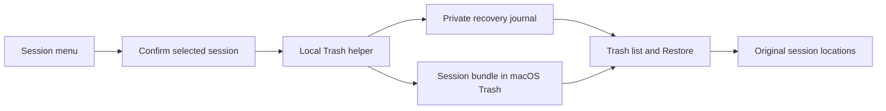

# Agent Workspace

A workspace enhancement pack for Herdr: Files and Changes sidebars with right-click menus, Sessions for Claude Code / Codex / agy, and Status with remaining or used account quota. Keep the familiar tree, read-only file preview, and Git diff view. Add path copying, local macOS file actions, and per-file staging and unstaging.

Agent Workspace is the package and visible layout name. Files Plus and Sessions Plus retain their `files-plus` / `sessions-plus` mod IDs and shared-state keys. Recognize an existing legacy `files-plus` layout when updating.

*Native component preview with sample data; menus are inline and actions are disabled. This is not an end-to-end interaction capture.*

## What you see

The sidebar follows the active Herdr theme. A rounded 10px panel uses `background`, `foreground`, and `border` colors, with 13px body text. Its 42px header shows **Files** and consistent 24px tree/recent/pin/selection/search/menu buttons. A 30px breadcrumb row navigates the current root and folders; its pin controls the previewed file. File previews open in center tabs; the sidebar always keeps its navigation list.

Tree rows are 28px high, indented 18px per level. 12px chevrons and original 16px full-color file-type/folder pictograms identify items. Files, Search and Changes share the icon resolver; action icons use 14px monochrome SVGs. Git status letters use the theme's status colors. Folders precede files. The tree scrolls; text previews are read-only and use the configured font with syntax colors.

Both context menus are 252px wide. They show the item name at the top, 30px action rows, 7px separators between groups, and a footer for keyboard hints or errors. The selected row uses `selected`; Trash uses `ansi1`. Preferred menu height is 52px (22px title, 22px hint footer, and 8px outer padding) plus 30px per action row and 7px per separator. Cap it at 85% of viewport height divided by the current zoom. Keep the name and footer visible and let the action-list region scroll when the preferred height does not fit.

The Changes panel has a 38px tab header, branch summary, a scrollable list of 28px file rows, a virtualized diff with 20px lines, and a commit-message footer. A native vertical divider between file navigation and the diff toolbar lets users resize the two regions. Save the upper pane height under `files-plus.git-pane-sizes.v1`, independently for Changes/History and sidebar/expanded preview. Keep minimum heights for both panes; expanded diff-only mode fills the available space. Its commit button says **Commit Staged** and is enabled only when the local repository has staged changes and a message.

A centered 460×290px dialog shows an action title, the captured target path, either a name field or a Trash confirmation message, an error/status area, and Cancel plus an action button. Busy operations show **Working…** and prevent duplicate submission. The same dialog role shows Stage/Unstage progress without a text field: it displays the captured path, a working-file preservation message, and progress or error text. On failure, its buttons become **Close** and **Retry**.

## How it behaves

Left-click expands a folder or opens a captured read-only file preview in a center tab, preserving all terminal tabs. Right-click a row opens its own context menu without expanding it. Right-click empty tree space opens the root folder's menu. The header **⋯** opens the previewed file's menu, or the root menu while browsing.

Local macOS items offer **Open with Default App**, **Reveal in Finder**, **Copy Path**, **Copy Relative Path**, **Copy Name**, **New File…**, **New Folder…**, **Rename…**, **Move to Trash…**, and **Refresh**. The root omits Rename and Trash. Remote spaces and other operating systems offer the three copy actions and Refresh, with **File actions require local macOS** in the footer.

Relative paths start at the browser's current folder; its root copies as `.`. Creation uses the selected directory, or the selected file's parent. Creation and rename never overwrite an existing item. Trash always asks first and uses macOS's native Trash. Renaming or trashing a symbolic link acts on the link itself.

Hover selects a menu row. Up and Down wrap through rows; Enter activates one; Escape dismisses the menu. Enter submits a name field or confirms Trash. Cancel and Escape dismiss an idle dialog. Busy dialogs consume Escape and prevent dismissal or duplicate submission. Errors remain visible for correction or retry.

The clicked path, root, and machine are captured in the menu props. Switching focus while a menu or dialog is open never changes its target. Successful operations refresh matching browser copies and update paths for expanded folders and previews after rename or Trash. A local watcher and 10-second timer keep ordinary external changes visible.

In Changes, left-click selects a file's diff; right-click opens a menu for that file. All targets support copying their absolute path, repository-relative path, and name. Local macOS targets also support default-app opening, Finder reveal, and Stage/Unstage as their Git status allows. Deleted files have no Open action; Reveal locates their parent folder. A partially staged file can offer both Stage and Unstage. Selecting either closes the popup, opens the modal progress dialog, and immediately starts the operation. Success closes the dialog and refreshes the view; failure leaves Retry and the header close icon available. This keeps operation feedback alive independently of the popup. Stage acts on the whole selected file. Unstage updates only its index entry and preserves working-tree data, including in a repository with no first commit.

**Commit Staged** commits the repository's staged changes using the entered message. It never stages unstaged files implicitly. This includes changes staged outside this mod. The action is unavailable without staged changes or a message, and all Git mutations are disabled for remote or non-macOS targets.

Files / Changes show no agent status and install no global shortcuts. The independent Sessions Plus mod shows live agent status from Herdr.

## Built from

- One personal mod directory, `mods/files-plus/`, with `main.js`, `mod.json`, its helper modules, and bundled SVG icons.
- `main.js` delegates to browser (default), `role: "changes"`, `role: "menu"`, or `role: "dialog"`. Both panels share the menu role. The dialog role handles file prompts/Trash confirmation and immediate Stage/Unstage progress when `action` is `stage` or `unstage`. Overlays open the same mod with a captured `target` and action.
- The browser, Changes panel, and icons derive from Herdr's Apache-2.0 Files and Changes mods at commit `816d2057d83f0cbd3705926c0231fb12963ae0fb`.
- GPUI primitives from `gpui-kit`; flex containers, `EditorState`/`Editor`, and `InputState`/`Input` from `gpui-base`.
- Herdr APIs: `spaces`, `panes`, `focused`, `exec`, `readTextFile`, `watchFolder`, `theme`, `settings`, `window`, `props`, `openOverlay`, `closeOverlay`, `shared`, and `setShared`. Clipboard writes use the current GPUI context.
- `files-plus.change` stores the latest `{target, action, name, revision}` in shared state. Browser copies consume it only when root and machine match.
- Directory listing uses `sh`, with PowerShell support for Windows. Git decorations and diff previews use read-only Git commands. Explicit Stage/Unstage actions modify the selected path's index entry, and Commit Staged invokes a commit without an implicit add. Local macOS file actions use `/usr/bin/open` and `/usr/bin/osascript`.
- The JXA helper calls Foundation for creation and native Trash, and uses macOS's exclusive rename primitive. Paths are argv values, never inserted into executable source. Remote mutations are rejected before launching a process.
- `update.mjs` replaces the two installed mod directories from local source without backups, removes obsolete files, preserves existing layouts and shared state, and creates the plugin layout only when missing. It does not fetch code or change the active layout.
- `install.mjs` optionally duplicates a chosen layout, defaulting to `main`, as `layouts/Agent-Workspace.json`. Files references use the mod's default browser role (removing any old, previously ignored role prop); Changes references use `content.props.role: "changes"`, preserving other props. It reveals Files ancestors and selects Files in containing stacks when present, otherwise reveals Changes. Other branches keep their visibility and selection. Surrounding spaces, tabs, and terminals retain the source layout's mods. In the standard workspace, the companion footer renders device, optional branch, and agent status together with quota and the command-palette shortcut. The installer neither switches the active layout nor edits keys or shared state.

## Watch out

Herdr's shipped mods and layouts are replaced on startup. Use the unique `files-plus` name and a personal layout. Never overwrite an existing personal copy. Keep the mod's self-overlay names and `mods/files-plus/` asset references consistent if renaming it.

The initial release targets local macOS file actions. Herdr 0.1.12 supplies the required mod APIs. Remote paths must remain bound to their machine; they must never be passed to local Finder, `open`, or a mutating helper. Other operating systems retain browsing and copying, with no OS file actions promised.

The installer needs Node.js 22 or newer. Basic browsing and Git views use Herdr APIs; local typed previews, search, Mermaid, notes and hunk actions use the existing Node.js runtime. Project commands use the existing hc CLI; Sessions history uses Node.js and agy metadata uses macOS SQLite. Review the files before installing: the mod can read outside its own folder, run programs, and change explicitly selected local items. Remote reads and listings use Herdr's transport. Files / Changes make no direct network requests. Status queries account quota as described below.

Keep the shipped browser bounds: 500 entries per directory, 5,000 total, expansion depth 40, and preview text truncated at 400,000 characters. Changes retains a 1,000-file bound, 1,500 diff lines, and a 4,000-character line bound. Hide `.git`; report binary/unreadable files instead of treating them as editable text. This is not a text editor.

Reject empty names, `.`, `..`, separators, colons, and control characters for new names. Do not trim away valid spaces or interpolate shell metacharacters. Do not replace symlink destinations on creation or rename. Never offer rename/Trash for the browser root.

The shipped tabs mod remembers panel visibility for each space. Even though the copied layout reveals a panel, users may need to click Files or Changes; the installer must not alter that shared preference.

Stage/Unstage must never discard working-tree edits or treat a filename as a Git option/pathspec expression. Preserve the captured repository and machine. Do not copy the original Changes footer's implicit `git add -A` behavior; the enhanced footer commits only the index.

## Done when

1. `node --test tests/*.test.mjs` passes on macOS, including actual filesystem operations and installation into temporary fixture homes.
2. `herdr-app check` loads the installed `files-plus` mod without errors. Files, Changes, both context menus, and the dialog render correctly in a native isolated test window; inspect actual screenshots. Sample-data rendering previews are labeled as such and are not presented as end-to-end interaction evidence.
3. Right-clicking a file, folder, or empty tree space opens the corresponding menu. Right-clicking does not also expand the folder.
4. Clipboard actions produce the clicked item's full path, relative path, and name, including Unicode and spaces.
5. Create and rename succeed for new names, reject collisions without changing existing content, and refresh the tree. Renaming an expanded folder keeps its descendants associated with the renamed path.
6. Cancelling Trash preserves the item. Confirming Trash moves only the selected item to the native Trash; a symlink target stays intact.
7. Changing the focused pane after opening a menu does not redirect its action. A remote target never invokes a local file action.
8. Installation leaves the original layout, keys, and shared state byte-for-byte unchanged. It replaces both panel types, supports layouts with only one type, preserves other props, and initially prefers Files. An existing mod or destination layout causes a clear failure. Failed copying removes only the attempted installation.
9. A Changes row menu targets that row's repository-relative path. Stage/Unstage immediately shows its progress view; busy Escape cannot dismiss it, and failures offer Retry, with a click outside or Escape to close. The operation affects only that file; partial staging and an initial repository work correctly without deleting working-tree data. Deleted files cannot be opened and reveal their parent folder instead.
10. Commit Staged creates a commit from the index without staging unrelated files. A remote target never launches local OS actions or Git mutations.

## Sessions Plus companion

The package also contains an independent `mods/sessions-plus/` mod. It uses the public Herdr APIs only; no shipped mod, application core, provider hook, or provider session title is changed. History scans are read-only; explicit session Trash and Restore actions move the selected session files. For the standard workspace, `workspace-layout.mjs` moves Sessions into the right-panel stack, appends a Sessions button after Changes by wrapping the original tabs block, and renders the combined bottom bar through the companion footer role. Keep the shipped tabs mod block and its ID. The footer uses public Herdr APIs for the active device, optional branch, agent count, attention count, and command-palette shortcut; place quota immediately after that status summary, with the shortcut at the far right. Register the Sessions child ID in `workspace.panels` without enabling any disabled native panels, so the shipped tabs mod restores per-space choices. Custom Files-only layouts retain their original block id as a column containing both views. `--files-only` preserves the original installation scope.

`main.js` renders local history and running Herdr agents, folder/provider/source filters, date groups, update times, short IDs and title search. Source filters default to All sources and use recorded metadata, never title guesses. Its rename role delegates to `rename.js`; names live in shared state under `sessions-plus.names`, keyed by provider, store, and session id. Unidentified live agents use their terminal address and creation time instead. `model.js` handles identities, exact resume-ID matching, safe argv construction, and local space selection.

`history.mjs` is a Node.js helper, never imported by GPUI. It reads bounded head/tail slices of Claude/Codex JSONL files and the Codex title index. agy summary metadata is read from a private, temporary snapshot of its SQLite database and WAL; snapshots are deleted even after query errors. Source stores are never written. Scans return metadata; explicit Preview actions read at most the latest 512 KiB and return up to 6,000 characters for each latest visible user/assistant message. Antigravity message preview is explicitly unsupported. The helper has no network code or persistent message index. It revalidates session existence, executable availability, and the original directory before a resume.

A live row focuses its exact terminal. A history row resumes Claude Code, Codex, or agy in the original local directory, passing the ID as a separate argument and preserving provider configuration. Missing local spaces are created; remote spaces are never used for local history. Duplicate clicks share a short pending marker. Context and rename identities are captured before async work. Live/history association requires an exact visible provider resume ID; never infer it from a folder or title. Manually started sessions without a visible ID remain separate live rows.

Local history requires macOS and Node.js 22+. Normal CLI trust checks still apply. Remote history, provider-native renaming, attaching to agents outside Herdr, archived Codex sessions, and Claude files nested under `subagents/` are outside this version. Top-level Claude session files are classified by explicit `isSidechain` metadata; missing metadata stays Unknown source. Codex Main, Auto review and Subagent classifications use the recorded session source. Herdr upgrades keep these personal mods and layout; public mod API compatibility still needs checking.

Sessions validation includes all three formats, distinct provider IDs, partial/large logs, symlink exclusion, live ID matching, checkpointed and active agy WAL snapshots, source-file preservation, missing-directory rejection, literal argv, local/remote routing, duplicate clicks, captured-target rename, and installer integration. Native list and rename components are previewed with fictional data in `sessions-preview.png`. Tests do not resume a real conversation.

## Recoverable session Trash

The actions and confirmation roles use plain classes within the Sessions View. The helper accepts a captured session key or recovery token, never a UI-supplied file path. It re-resolves provider data, checks local ownership and file identities, rejects active writers, and uses exclusive filesystem moves. The same-volume restriction keeps bundles recoverable without guessing another volume's Trash path.

A bundle groups a recognized session transcript/database and session-specific attachments. agy WAL/SHM sidecars move with its database. Shared indexes and local aliases stay in place. Durable recovery records are kept in the app home's session-trash directory, separate from mod upgrades. Restore verifies the bundle and recorded file identities, rejects destination conflicts, and never empties the system Trash. Interrupted or failed moves preserve recoverable data; unexpected bundle contents are retained.

Shared operation markers coordinate resume with Trash/Restore in Herdr. A history revision schedules one refresh task after the current render, after a successful move or when a captured session has already disappeared. Never call notify from render: it throws and can leave the loading flag stuck. Coalesce revisions while scans are pending. A typed SESSION_MISSING result closes only stale deletion dialogs; other failures remain retryable. The helper's separate lock protects concurrent filesystem requests across views/processes. Prune the index of a completed trashed entry only after both its Trash and staging bundles are confirmed missing. Retain damaged, unreadable, and interrupted recovery entries. Use a trash-can icon with a Session Trash tooltip for the Sessions header entry. Process checks target the selected session ID and its open files, not every process of the same provider.

## Status and provider icons

Sessions Plus exposes a compact quota strip in the combined bottom footer, immediately after the device/branch/agent summary on the left. A native Popover contains the full quota panel; both use the same Quota instance. Use an Orca-style strip: the English Remaining/Used mode label, provider icon, slim progress bar, up to two explicitly labeled window percentages/countdowns (such as 5h and 7d, each with its own countdown; an unknown five-hour reset displays a fixed 5h default identified in its tooltip, other unknown resets display —), and a single small curved-arrow refresh button at the right. Spin the button while a query is pending, dim and disable it during the 60-second cooldown, and show cooldown/update/error feedback in its tooltip. Re-enable it when the cooldown ends. Keep controls and tooltips in English. Open the readings or the Quota entry to manage provider visibility through Agents in the full quota Popover. When width is limited, omit progress bars first, then percentages while keeping both labeled countdowns; if the values still do not fit, keep agent icons with warnings, then use a clickable Quota label with a combined warning at the smallest widths while keeping the mode and refresh button. The bar selects the lowest remaining window; tooltips and full details retain all windows. Legacy custom layouts retain the Status tab. It shows branded Claude Code, Codex and agy cards with Remaining/Used modes, separate provider quota windows, reset countdowns and last-update times. The mode and hidden-provider selection are local preferences; quota snapshots stay in memory. Missing CLI or signed-out results hide that provider card. Other failed refreshes may keep a previous snapshot stale; first-query failures show a warning card without invented quota values. Initial loading is shown once for the panel, not as empty provider cards. The status bar polls every five minutes and redraws countdowns every thirty seconds, with a one-minute manual refresh cooldown; expanding its popup adds no queries. Legacy Status tabs only poll while selected. The Agents control persists hidden provider IDs under `sessions-plus.quota-hidden`. Initial, manual, and automatic reads skip hidden providers; already running reads may complete. Re-showing a provider refreshes only that provider within the same pending/cooldown guards. When all cards are hidden or no usable readings are available, keep a clickable Quota entry so the Popover and its Agents selector remain accessible. Sessions filters are independent.

quota-model.js validates and normalizes numerical fields. quota.js draws the cards and launches one quota.mjs helper per provider. Claude credentials remain inside the helper and are sent only to the fixed Anthropic HTTPS usage endpoint, with redirects rejected. Codex uses its documented app-server account/rateLimits/read request, never a thread or turn, and cleans up its temporary process and logs. agy version-gates its built-in /usage command, suppresses auto-update for the query, and pauses a version if the response unexpectedly represents a model turn. No raw credentials, account IDs, emails, or subprocess/server error bodies enter the view or logs.

Sessions rows, selectors, quota cards, and the quota strip load Herdr's managed `icons/claude.svg`, `icons/codex.svg`, and `icons/antigravity.svg` through `image`. The plugin does not bundle copies of these SVGs. The legacy `sessions-preview.png` and `status-preview.png` images reproduce Herdr/LobeHub icons; retain their MIT notice in `mods/sessions-plus/icons/LICENSE`. Status checks cover zero/exhausted/missing quotas, complementary percentages, real reset units, named pools, unmetered buckets, authentication/network errors, credential redaction, safe agy versions, and the Codex read-only protocol and process cleanup. status-preview.png contains fictional values only.

Quota query failures use a 13px warning-triangle SVG after the affected agent in the bottom strip and beside its update time in the card. Reserve the icon width and gap in compact sizing. After bars and percentages are hidden, keep agent icons with warnings; if those cannot fit, show a combined warning beside Quota. Preserve prior readings as Stale, and show first-query failures without inventing percentages or a successful timestamp. Successful refreshes clear warnings. Missing CLIs and signed-out accounts remain omitted.

Refresh controls use the same `refresh.svg`, a 14px glyph centered in a 24px square button, accessible labels and hover feedback. While loading, disable the button and spin the glyph at 850ms; never replace it with a font arrow or ellipsis. Keep the quota cooldown in the tooltip. Warning SVGs sit inside plain div wrappers so native tooltips are available.

Dialogs have no title close button. Open them as non-modal dialogs, so a click outside closes them as system dialogs do, and keep Escape. Use `frame: "none"` with a rounded 10px bordered root to avoid duplicate host controls. Retain Cancel as an operation action; Escape and Cancel stay disabled during pending mutations. A click outside closes only the dialog: the native operation still runs to completion.

## Gallery-derived workspace features

Keep the implementation native, using the existing Node, Git and rg tools. Mermaid uses a bundled, licensed renderer with no runtime package installation, browser, network request or service. Local Search resolves rg from PATH, common installation folders and the existing Codex standalone bundle; Search view `props.rg` can select an executable explicitly. Do not install another package or extension. Files owns typed local previews and read-only search. Changes owns independent staged/unstaged diffs and paginated Git history. Sessions owns source-aware filters and on-demand recent-message preview, plus the activity inbox.

The Agent inbox groups live native statuses as Needs you, Finished and Working. Clicking an entry focuses its agent. Dismiss hides the current update; Show dismissed reveals hidden rows and Show restores one. New activity returns automatically. Missing activity sequences use Snooze 1m instead of permanent dismissal; ended or disconnected terminals are excluded. Do not stop processes or duplicate native notifications.

Do not install hooks, add model calls, create transcript indexes, fetch remotes automatically or mutate real sessions during tests. Use bounded helpers and isolated fixtures; reject stale async results. Typed views must release retained editor/input state. Both mods need a passing native check and interactive verification after updates. The installer/updater must copy every helper module and preserve shared state and existing keybindings.

Quota tooltips use one provider/mode heading, followed by one line per window. Omit duplicate window headings and internal Bar explanations; generic Codex pool names do not repeat the provider name, while named model pools stay visible.

## File navigation

Use Herdr shared state `files-plus.library.v1` for machine/root-scoped recent files and pins. Keep 20 recent entries, 40 pins and 40 projects; store relative paths only. Opening Search results also records recent files. Pin/forget actions change metadata only. File clicks in Tree, Recent and Pinned use `tab.new` with a `file-preview` role. The sidebar keeps its navigation at all widths. A `files-plus.file-tabs.v1` registry tracks verified live mod panes by space, machine, project and path; never deduplicate by tab title. Register the created tab by the before/after tab difference, and use a bounded pending request while discovery completes. Follow the captured project context in Files, Changes and Sessions. Only active preview tabs poll file contents; release retained preview state on close. Breadcrumbs are compact, bounded and truncated with full-path tooltips.

Files has no multi-select or batch file operations: a click opens one item, with or without modifier keys. Update pins/recent paths from the exact successful rename and Trash mutations.

## Review, prompt queue and Markdown enhancements

Review extends the existing Changes and History diffs instead of replacing them. Retain before/after line identities, captured comparison versions and bounded original excerpts. Persist bounded comments and content-versioned Viewed records per machine and checkout. A line/range or whole-file comment opens the review-comment role; the review role shows the full editable message and an explicitly selected live recipient. Never silently truncate a submitted review. Revalidate source versions and recipient identity before delivery; stale comments stay visibly outdated. Delivery uncertainty preserves the draft, prevents automatic retries and needs explicit resolution. No Git mutations or remote fetches belong to review.

The Sessions prompt-queue role stores bounded pending/sent instructions for an exact recorded session or, when unknown, its captured terminal incarnation. Folder similarity is never identity. Separate it from the incoming activity inbox. Editing a sent instruction makes it pending again. Explicit single/all sends revalidate the live agent and mark only acknowledged items sent; uncertain delivery stays reviewable and never retries automatically. No shell recipient, hidden auto-send, hook, model call or permission-bypass flags.

Markdown navigation parses headings outside code fences, supports repeated/Unicode anchors and captured local/remote Markdown targets, and preserves drafts when navigating Back. The native text view cannot promise arbitrary pixel scrolling: selecting a section may render from its heading, with a way back to the whole document. Mermaid renders supported diagram families natively with bounded source, diagram count, output size and cache retention; invalid, unsupported or oversized input exposes source and error. Preserve renderer notices and a reproducible build/check path. Keep editing, conflict checks, source Find and existing preview limits intact.

## References, notes, commands and workspace folders

File/folder context menus and Search's selected-result **Add reference** open Sessions Plus's reference role with captured root, relative path, machine and optional line. Select a supported live recipient on the same machine, review the text and explicitly add it to pending prompts. Adding a reference or note never sends it. Preserve existing queue items and composer drafts, then open that recipient's queue for a separate explicit send.

Notes opens from Sessions header/session rows or Project Spaces context menus. Keep Project, Session and Global identities distinct; All notes searches saved notes and recovery drafts from closed contexts. Save after typing pauses and on explicit Save; preserve per-view drafts and stale-write conflict text. Persist bounded notes under appHome/data/workspace-notes/notes.json, outside mod directories, with three previous saved versions. Retain archive/unarchive, explicit version clearing and confirmed archived-note removal; keep removed latest text as a recovery draft. Node handles bounded storage validation while atomic expected writes protect the saved file.

Project commands opens from Sessions or a captured Project Spaces context menu. Templates are entered manually as title, absolute cwd and literal argv JSON, scoped by project and machine; support favorite/order/edit/remove and durable unfinished forms. Never discover or run commands automatically. Only Run starts a detached hc task; closing the panel keeps it running. Console focuses its live terminal or reads bounded finished output. Cancel requires confirmation and fresh verification of the reserved task's labels, terminal creation identity and command before stopping it. Preserve drafts from simultaneous views instead of overwriting another view's form.

Workspace folders composes existing browsers for up to eight roots on one machine. Save and reset only metadata for the captured workspace; changing focus to a linked preview must not detach the configured roots. Keep row IDs and file actions bound to each root. Header Search captures all roots; a root's own search captures just that root. Search groups and previews retain root/machine identity for same-name paths. Fold roots independently, stop watchers for paused/closed children, consume matching file mutations for every child, and release removed child browsers. Shared metadata changes must synchronize without notifications or writes during render.

## Selected-hunk index actions

Changes retains whole-file Stage File / Unstage File and adds a hunk toolbar. Clicking a @@ header or the navigation arrows chooses one complete captured hunk. Enable Stage hunk / Unstage hunk only for local macOS, Staged/Unstaged regular tracked text files with M status, no conflicts/mode change and a complete bounded patch. Reject binary, added, deleted, renamed, history, remote and incomplete/oversized inputs.

The helper revalidates HEAD, selected index entry, working content and exact canonical patch, acquires only its own exclusive index.lock, applies to an isolated index, then verifies the complete original index before atomic publication. Preserve partial staging, other staged files and working content. Never remove a foreign lock, overwrite a concurrently replaced index, auto-retry ambiguous results or mutate a real project index in tests. Cover ordinary and linked worktrees, stale source versions and cancellation with temporary fixture repositories.

## Workspace operations additions

Sessions exposes Services / Projects / Lineage in a compact row below its existing header; Changes exposes PR / CI and Graph beside History. Keep existing layouts and keybindings unchanged. All new roles remain inside the two installed mods and reuse the existing native overlay and pending-reference flows.

- `sessions-plus/services*.js`, `services-helper.mjs` and `ports-model.js`: capture machine identity; bounded Docker/port probes only on open/Refresh, logs on demand, partial errors explicit. Restart requires explicit confirmation, a cross-view reservation and fresh engine/container ID/creation checks. URL actions require a fresh exact local loopback listener. No process termination, tunnel, cleanup or daemon startup.
- `sessions-plus/presets*.js`: bounded manually saved presets and independent CAS drafts; preview before launch. Create only a new space in an existing checkout, then extra tabs, using exact CLI ACK IDs and fresh app/core identity checks. Preserve step results and mark partial/uncertain outcomes without retry or automatic deletion. Shared file roots use the existing workspace mapping format. No automatic prompt, worktree or dependency installation.
- `sessions-plus/lineage*.js`: build a cycle-safe forest using only core parent links, keeping machine-qualified addresses distinct; filter with ancestor context, fold, and fresh-check before terminal.peek. Do not read provider transcripts or infer links from matching folders.
- `files-plus/github*.js` and `github-helper.mjs`: read only through existing gh credentials; capture repository and machine, bounded PR/check/thread/log data, stale retention, no background polling. A missing CLI stays a visible unavailable state and must not trigger installation or login. Only explicitly open the existing reference confirmation to queue context; never send automatically.
- `files-plus/graph*.js` and `graph-helper.mjs`: bounded topological Git reads with no optional index locks, external diff, signature process or fetch. Native PathBuilder lanes are painted by pure virtual row renderers; the list owns selection handlers. Validate revision keys and captured SHA, then reuse the existing Changes commit diff role.

Validation requires pure model and production-class race/identity tests, actual temporary Git topology tests, fake Docker/gh process bounds, isolated native nonempty checks, and source/installed equality. Preset launch is verified only in a disposable app/core with fixture programs. Do not restart or mutate real projects to demonstrate UI features. This installation deliberately has no gh; do not claim real GitHub or remote-machine validation.

## Activity and delivery tools

Expose timeline/gallery as explicit session actions and deliverables/screen-picker in a responsive tools dialog. Resolve provider + store + session ID exactly and reject remote or ambiguous history. Keep transcript parsing and image validation/cache work in the bounded short-lived Node activity helper. Paginate native rich rows, clip summaries, show only explicit recorded durations and distinguish tool targets from proof of edits. Never fetch image URLs or infer attachments from ordinary prompt text.

Deliverables live outside runtime mod folders in data/workspace-deliverables/store.json. Use the same lock, expected item revision and atomic rename for UI and explicit CLI additions. Keep forms recoverable, file references machine-qualified, and open only after an explicit click. Removing records never removes artifacts. Treat normal file replacement as a bounded retry, while rejecting symbolic links, hard links and foreign owners. Keep an open descriptor through dead-owner verification and identity-checked unlink; publish complete lock-owner records and retain legacy PID recovery.

Screen picker captures the exact live terminal creation identity, argv/pid/cwd and machine before any await, verifies before and after bounded reads, and treats output only as data. Copy literal selections; preview only within the captured filesystem root; only explicit HTTP(S) links open externally. References enter the existing confirmation flow rather than being sent automatically.

Use the same screenshot-mode shared key and identical private guard module in each owned mod. Guard every main render, including overlays and preview pane headers. Keep the toggle and Reveal available without printing private values. Clearly state that terminal text, native tabs/notifications and unrelated mods remain visible.

Sidebar study: Orca's project/worktree hierarchy, Better Sidebar's combined space/tab/agent tree and Over9k's inline facts informed the sample-data proposal in previews/sidebar-proposal.png. This proposal is not installed as a new sidebar.

Project Spaces: keep density in its own shared key, with Detailed/Compact and truthful local/remote paths. Avoid duplicating the same project path on every nested space; mixed manual groups must not claim one folder. Keep complete groups/rows for ordering and drag assignments, and filter only a separate rendered projection. Search may temporarily unfold matching groups without changing stored folds.

## Unified sidebar

The unified option reuses Project Spaces grouping, Git metadata, path display, menus and drag assignment. Its local unified-model.js projects API snapshots into machine-qualified project/space/tab/agent/child rows. Identity and parent/ownership evidence must be explicit; folders never join agents. Promote pinned and attention branches without duplicates, merge single-terminal tabs, and preserve shell/mod/empty-space navigation. Status sections follow individual branches rather than hiding unrelated work under a whole-space status.

Keep native rows paginated and snapshot processing cached. Detailed permits two title lines plus bounded metadata; Compact keeps a small row. Revalidate captured terminal creation identity and ownership before navigation or pinning. Preserve viewed-done behavior, keyboard agent order and screenshot masking. Do not start, close or stop sessions merely to populate the view.

Layout migration is opt-in via --unified-sidebar / --separate-sidebar and records the exact original owned blocks for reversible restoration. Only the recognized standard sidebar pair may be replaced; preserve unrelated layout nodes, keys and settings. Refuse unknown/conflicting shapes instead of deleting user blocks. Default updates preserve the chosen mode.

Keep Files / Changes / Sessions in the original top-right window toolbar. Sidebar mode switches use native popovers, while normal/icon controls stay in local centralized helpers with content-sized labels. Action buttons follow the shipped Spaces/chrome pattern: transparent at rest, with theme hover feedback; never paint the Files panel background over sidebar chrome. Keep selected segment feedback distinct from action buttons. Do not import JavaScript from another mod folder or change application-wide semantic tokens to restyle these controls.

Directory pins use their own shared record, keyed by exact workspace IDs and canonical project keys. Keep them independent of terminal pin labels and project assignments. Explicit pins move the whole directory, including previews and empty tabs; unpin restores automatic grouping. All pinned child directories carry their project heading. Cross-directory parent branches may split for display while captured parent identity remains unchanged for action validation.

Show persistent, normally flowing pin controls on explicitly pinned project and workspace rows in both views. Direct unpin revalidates live ownership and removes only the captured directory preference. Inherited and automatically grouped pins are muted source indicators. Keep project and directory rows transparent; use full-row hover and retain selection only on the focused task.

Task status glyphs and labels share a non-shrinking trailing line; Detailed metadata below the title contains muted context only. Color and label the task own state; keep child activity explicitly prefixed and full tooltips intact. Idle remains muted, and unknown states do not invent an Idle label.

Reserve terminal status and pin slots continuously; hover changes pin visibility without changing title width. Anchor detailed status text to the same trailing edge as its status icon, retaining automatic right alignment as the sidebar resizes. Keep metadata height reserved in normal flow.

Reserve the 19px pin slot continuously, but size project counts, directory controls and task status columns to their own content needs. Counts and task statuses share a 5px right inset. Keep directory branch and Git ahead/behind facts beside relative path metadata, with full tooltips and no invented values. Preserve vertically centered controls in Compact mode.

Right panels read the existing sidebar density preference without cross-mod imports. Keep exact root/machine identity for multi-folder Files views and capture menu context across project switches. Files filtering only projects loaded entries; project search retains the bounded full-workspace search flow. Sessions packs scope and filters into popovers, preserves every workspace tool in the global menu and keeps captured-row actions independent. Changes mode and repository tools use popovers without changing Git write, review or hunk validation.
