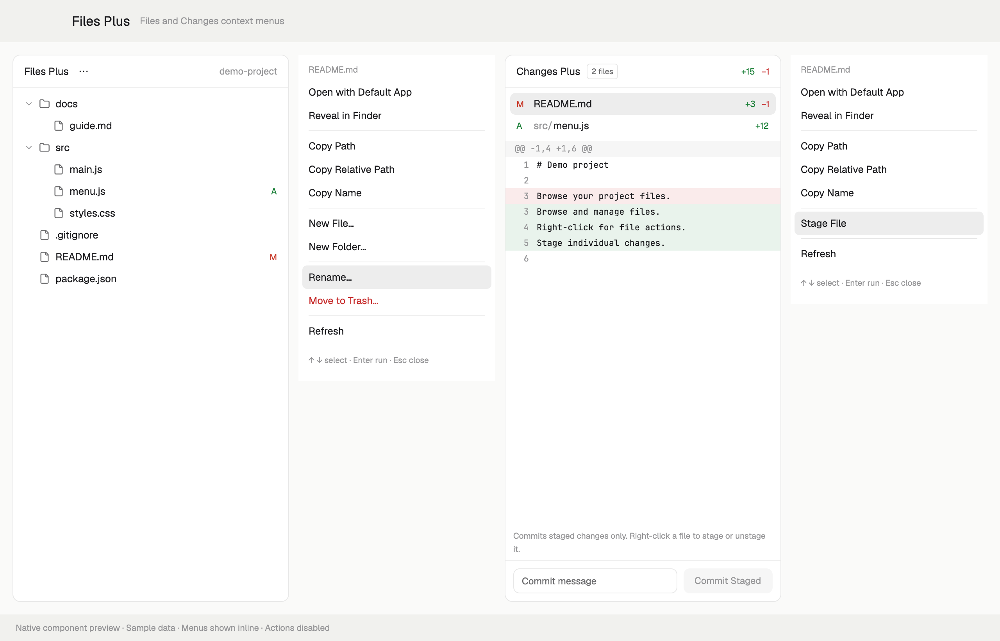

# Files Plus

Files and Changes sidebars for Herdr with right-click menus. Keep the familiar tree, read-only file preview, and Git diff view. Add path copying, local macOS file actions, and per-file staging and unstaging.

*Native component preview with sample data; menus are inline and actions are disabled. This is not an end-to-end interaction capture.*

## What you see

The sidebar follows the active Herdr theme. A rounded 10px panel uses `background`, `foreground`, and `border` colors, with 13px body text. Its 42px header shows **Files Plus**, a **⋯** menu button, and the current folder or previewed file. A back arrow returns from the preview to the tree.

Tree rows are 28px high, indented 18px per level. Chevron and folder/file SVGs identify items. Git status letters use the theme's status colors. Folders precede files. The tree scrolls; text previews are read-only and use the configured font with syntax colors.

Both context menus are 252px wide. It shows the item name at the top, 30px action rows, 9px separators between groups, and a footer for keyboard hints or errors. The selected row uses `selected`; Trash uses `ansi1`. Preferred menu height is 38px plus the rows and separators plus a 44px footer. Cap it at 85% of viewport height divided by the current zoom. Keep the name and footer visible and let the action-list region scroll when the preferred height does not fit.

The Changes panel keeps a 42px header with file counts and added/deleted totals, a scrollable list of 28px file rows, a virtualized diff with 20px lines, and a commit-message footer. Its commit button says **Commit Staged** and is enabled only when the local repository has staged changes and a message.

A centered 460×290px dialog shows an action title, the captured target path, either a name field or a Trash confirmation message, an error/status area, and Cancel plus an action button. Busy operations show **Working…** and prevent duplicate submission. The same dialog role shows Stage/Unstage progress without a text field: it displays the captured path, a working-file preservation message, and progress or error text. On failure, its buttons become **Close** and **Retry**.

## How it behaves

Left-click expands a folder or opens a text preview. Right-click a row opens its own context menu without expanding it. Right-click empty tree space opens the root folder's menu. The header **⋯** opens the previewed file's menu, or the root menu while browsing.

Local macOS items offer **Open with Default App**, **Reveal in Finder**, **Copy Path**, **Copy Relative Path**, **Copy Name**, **New File…**, **New Folder…**, **Rename…**, **Move to Trash…**, and **Refresh**. The root omits Rename and Trash. Remote spaces and other operating systems offer the three copy actions and Refresh, with **File actions require local macOS** in the footer.

Relative paths start at the browser's current folder; its root copies as `.`. Creation uses the selected directory, or the selected file's parent. Creation and rename never overwrite an existing item. Trash always asks first and uses macOS's native Trash. Renaming or trashing a symbolic link acts on the link itself.

Hover selects a menu row. Up and Down wrap through rows; Enter activates one; Escape dismisses the menu. Enter submits a name field or confirms Trash. Cancel and Escape dismiss an idle dialog. Busy dialogs consume Escape and prevent dismissal or duplicate submission. Errors remain visible for correction or retry.

The clicked path, root, and machine are captured in the menu props. Switching focus while a menu or dialog is open never changes its target. Successful operations refresh matching browser copies and update paths for expanded folders and previews after rename or Trash. A local watcher and 10-second timer keep ordinary external changes visible.

In Changes, left-click selects a file's diff; right-click opens a menu for that file. All targets support copying their absolute path, repository-relative path, and name. Local macOS targets also support default-app opening, Finder reveal, and Stage/Unstage as their Git status allows. Deleted files have no Open action; Reveal locates their parent folder. A partially staged file can offer both Stage and Unstage. Selecting either closes the popup, opens the modal progress dialog, and immediately starts the operation. Success closes the dialog and refreshes the view; failure leaves Retry and Close available. This keeps operation feedback alive independently of the popup. Stage acts on the whole selected file. Unstage updates only its index entry and preserves working-tree data, including in a repository with no first commit.

**Commit Staged** commits the repository's staged changes using the entered message. It never stages unstaged files implicitly. This includes changes staged outside this mod. The action is unavailable without staged changes or a message, and all Git mutations are disabled for remote or non-macOS targets.

This mod shows no agent status and installs no global keyboard shortcuts.

## Built from

- One personal mod directory, `mods/files-plus/`, with `main.js`, `mod.json`, its helper modules, and four SVG icons.
- `main.js` delegates to browser (default), `role: "changes"`, `role: "menu"`, or `role: "dialog"`. Both panels share the menu role. The dialog role handles file prompts/Trash confirmation and immediate Stage/Unstage progress when `action` is `stage` or `unstage`. Overlays open the same mod with a captured `target` and action.
- The browser, Changes panel, and icons derive from Herdr's Apache-2.0 Files and Changes mods at commit `816d2057d83f0cbd3705926c0231fb12963ae0fb`.
- GPUI primitives from `gpui-kit`; flex containers, `EditorState`/`Editor`, and `InputState`/`Input` from `gpui-base`.
- Herdr APIs: `spaces`, `panes`, `focused`, `exec`, `readTextFile`, `watchFolder`, `theme`, `settings`, `window`, `props`, `openOverlay`, `closeOverlay`, `shared`, and `setShared`. Clipboard writes use the current GPUI context.
- `files-plus.change` stores the latest `{target, action, name, revision}` in shared state. Browser copies consume it only when root and machine match.
- Directory listing uses `sh`, with PowerShell support for Windows. Git decorations and diff previews use read-only Git commands. Explicit Stage/Unstage actions modify the selected path's index entry, and Commit Staged invokes a commit without an implicit add. Local macOS file actions use `/usr/bin/open` and `/usr/bin/osascript`.
- The JXA helper calls Foundation for creation and native Trash, and uses macOS's exclusive rename primitive. Paths are argv values, never inserted into executable source. Remote mutations are rejected before launching a process.
- `install.mjs` optionally duplicates a chosen layout, defaulting to `main`, as `layouts/files-plus.json`. Files references use the mod's default browser role (removing any old, previously ignored role prop); Changes references use `content.props.role: "changes"`, preserving other props. It reveals Files ancestors and selects Files in containing stacks when present, otherwise reveals Changes. Other branches keep their visibility and selection. Surrounding spaces, tabs, terminals, and status bar remain the source layout's own mods. The installer neither switches the active layout nor edits keys or shared state.

## Watch out

Herdr's shipped mods and layouts are replaced on startup. Use the unique `files-plus` name and a personal layout. Never overwrite an existing personal copy. Keep the mod's self-overlay names and `mods/files-plus/` asset references consistent if renaming it.

The initial release targets local macOS file actions. Herdr 0.1.12 supplies the required mod APIs. Remote paths must remain bound to their machine; they must never be passed to local Finder, `open`, or a mutating helper. Other operating systems retain browsing and copying, with no OS file actions promised.

The optional installer needs Node.js 22 or newer; the runtime mod needs no Node.js. Review the files before installing: the mod can read outside its own folder, run programs, and change explicitly selected local items. Remote reads and listings use Herdr's transport. There are no direct network requests.

Keep the shipped browser bounds: 500 entries per directory, 5,000 total, expansion depth 40, and preview text truncated at 400,000 characters. Changes retains a 1,000-file bound, 1,500 diff lines, and a 4,000-character line bound. Hide `.git`; report binary/unreadable files instead of treating them as editable text. This is not a text editor.

Reject empty names, `.`, `..`, separators, colons, and control characters for new names. Do not trim away valid spaces or interpolate shell metacharacters. Do not replace symlink destinations on creation or rename. Never offer rename/Trash for the browser root.

The shipped tabs mod remembers panel visibility for each space. Even though the copied layout reveals a panel, users may need to click Files or Changes; the installer must not alter that shared preference.

Stage/Unstage must never discard working-tree edits or treat a filename as a Git option/pathspec expression. Preserve the captured repository and machine. Do not copy the original Changes footer's implicit `git add -A` behavior; the enhanced footer commits only the index.

## Done when

1. `node --test tests/*.test.mjs` passes on macOS, including actual filesystem operations and installation into temporary fixture homes.
2. `herdr-app check` loads the installed `files-plus` mod without errors. Files, Changes, both context menus, and the dialog render correctly in a native isolated test window; inspect actual screenshots. Sample-data rendering previews are labeled as such and are not presented as end-to-end interaction evidence.
3. Right-clicking a file, folder, or empty tree space opens the corresponding menu. Right-clicking does not also expand the folder.
4. Clipboard actions produce the clicked item's full path, relative path, and name, including Unicode and spaces.
5. Create and rename succeed for new names, reject collisions without changing existing content, and refresh the tree. Renaming an expanded folder keeps its descendants associated with the renamed path.
6. Cancelling Trash preserves the item. Confirming Trash moves only the selected item to the native Trash; a symlink target stays intact.
7. Changing the focused pane after opening a menu does not redirect its action. A remote target never invokes a local file action.
8. Installation leaves the original layout, keys, and shared state byte-for-byte unchanged. It replaces both panel types, supports layouts with only one type, preserves other props, and initially prefers Files. An existing mod or destination layout causes a clear failure. Failed copying removes only the attempted installation.
9. A Changes row menu targets that row's repository-relative path. Stage/Unstage immediately shows its modal progress view; busy Escape cannot dismiss it, and failures offer Retry/Close. The operation affects only that file; partial staging and an initial repository work correctly without deleting working-tree data. Deleted files cannot be opened and reveal their parent folder instead.
10. Commit Staged creates a commit from the index without staging unrelated files. A remote target never launches local OS actions or Git mutations.
